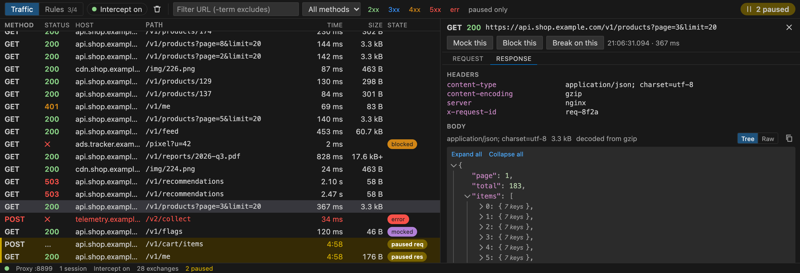
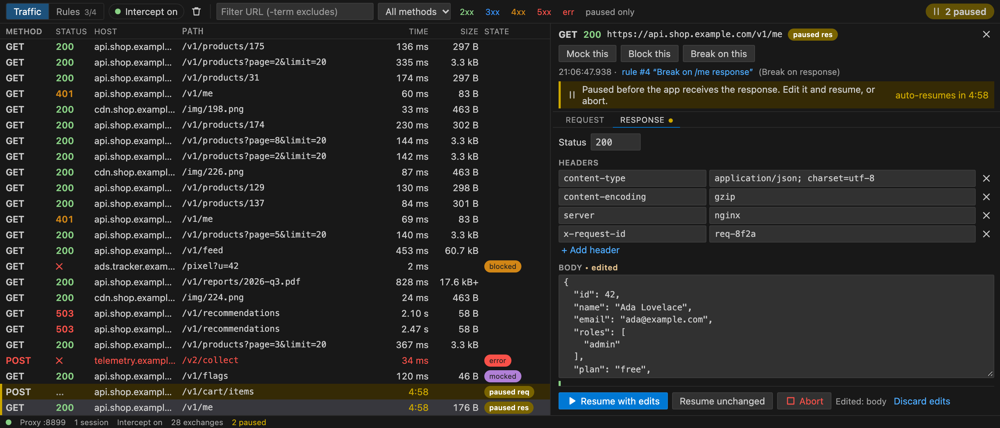
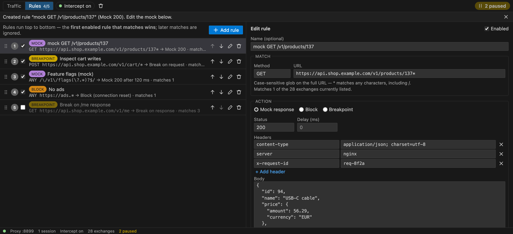
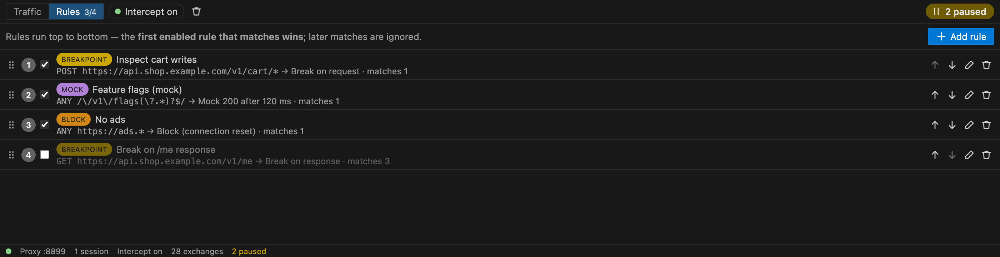
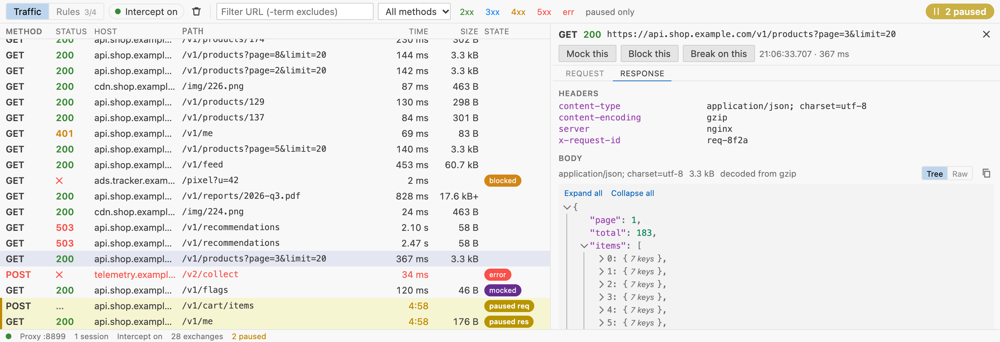

# Flutter Intercept

**View, pause, edit, block and mock your Flutter app's HTTP traffic, right inside VS Code.**
You add no code to your app and there's nothing to set up: install the extension, press **F5** as usual,
and the traffic shows up.



- Works with **Dio**, **package:http** and plain **`HttpClient`**, which covers anything built on `dart:io`.
- **gRPC** calls from grpc-dart are intercepted too, each message decoded with your app's own generated code (or
  your `.proto` files). Pause, edit, mock, rewrite, script, reroute, resend, record and replay them like HTTP
  requests, or copy one as a `grpcurl` command. gRPC-Web calls from Flutter Web are shown as gRPC calls too.
- HTTPS works too, and you don't install a certificate on the device, simulator or Mac.
- Your app's code is never changed. Nothing is added to `pubspec.yaml`, and `flutter build` / CI never see the
  tool.

## How it works

1. When you start a Flutter (or Dart) debug session, Flutter Intercept writes a small launcher to
   `.dart_tool/flutter_intercept/entry_<name>.dart` and runs that instead of `lib/main.dart` (or your flavor
   target). Flutter's default `.gitignore` already ignores `.dart_tool/`.
2. The launcher installs `HttpOverrides`, which send every `HttpClient` to a proxy on your machine
   (`PROXY <host>:<port>; DIRECT`), and makes the app trust that proxy's certificate authority. An `IOOverrides`
   hook sends grpc-dart's connections to the same proxy; every other socket is left alone. It then calls your real
   `main()`.
3. A man-in-the-middle proxy inside the extension records each exchange and applies your rules. The panel at the
   bottom of VS Code shows the traffic.
4. If the proxy isn't reachable, requests go `DIRECT` and the app keeps working. Builds made outside VS Code
   (`flutter build`, `flutter run` in a terminal, CI) are untouched.

## Features

**Live traffic list**
- Every request shows its method, status, host, path, time, size and state (paused, mocked, blocked, error).
- Filter by URL text, method, status class (2xx–5xx, errors) or paused only. The text box also takes filters:
  `m:POST`, `s:4xx`, `s:error`, `t:json`, `body:"token"`, `h:authorization`, `state:mocked`, `src:login_page.dart`,
  `grpc:unavailable` (prefix any of them with `-` to exclude).
- Keyboard navigation and a resizable detail pane.

**Where a request came from**
- The detail pane shows the line of your code that made the request (for example
  `CatalogApi.fetchAlbum  lib/api/catalog_api.dart:37`). **Open source** jumps there; expand it for the whole
  stack. Works with `package:http`, `HttpClient` and Dio (including interceptors).
- In profile builds Dio requests get no call site, and columns are missing (AOT stacks are shorter).
- Turn it off with `flutterIntercept.captureSource`.

**Model check: your models vs the real API**
- Every JSON response is checked against your json_serializable / freezed models — the generated
  `_$UserFromJson` in `*.g.dart`, which is exactly what runs on it.
- A field that would make `fromJson` throw (a `null` in a non-nullable field, a string where an `int` belongs,
  an unknown enum value) is shown on the request and as an error on that field in your model file.
- Requests are matched to models through Retrofit / Chopper declarations or the call stack; pick one yourself
  with **Check against a model…**. Turn it off with `flutterIntercept.contractCheck`.

**Break a field on purpose**
- Right-click a field in a response: **Make null in next responses**, **Remove from next responses** or
  **Change value…**. Or add a **Mutate JSON** rule. The real response reaches your app with that change. This works
  on decoded gRPC response messages too.

**Generate code**
- **Generate Dart model** (freezed, json_serializable or plain, matching your project) from every recorded
  sample of a route, and **Generate test fixture** (JSON fixtures + a http_mock_adapter / MockClient / mocktail
  test). Both open as unsaved editors.

**WebSockets, SSE and GraphQL**
- WebSocket connections and Server-Sent Events streams are recorded message by message, live, in a **Messages**
  tab. Block and fault rules work on sockets.
- GraphQL requests show their operation name; filter with `op:getUser` and match rules to one operation.

**gRPC**
- Calls from grpc-dart (and connectrpc's HTTP/2 transport over plain-text h2c) are listed with no app code: the
  method (`/shop.v1.CartService/AddItem`), the gRPC status (`OK`, `14 UNAVAILABLE`…), trailers, streaming and
  message counts.
- A **Messages** tab shows every message both ways, decoded to JSON with your app's own generated `*.pb.dart` code
  or the `.proto` files in your workspace, or as raw field numbers without either.
- **gRPC mock** rules answer a method with your messages and status; **Mock this** on a call starts from its real
  response. Block, fault, throttle, network profiles and sequences work on gRPC calls too.
- **Breakpoints** pause each message both ways and the end of the call (status and trailers): edit the message as
  JSON, drop it, change the final status, or abort the call. **Mutate JSON** rules change fields in real response
  messages.
- **Recordings** save gRPC calls with their messages; replay answers them without the server, and a diff compares
  their status, message counts and response shape.
- **Rewrite** rules change a call's metadata and trailers, **Script (JS)** rules run `onGrpcMessage` /
  `onGrpcStatus` on its messages and status, **Map remote** sends it to another server, and **Resend** / **Edit and
  resend** send it again with its recorded or edited messages. **More rules…** on a call starts any of these rules for
  its method.
- **gRPC-Web** calls from Flutter Web (`GrpcWebClientChannel`) are shown as gRPC calls, with their messages, status
  and trailers; gRPC mock and block rules answer them in gRPC-Web format.
- **Copy as grpcurl** turns a gRPC call into a `grpcurl` command that calls the real server.
- gRPC over TLS is listed as an undecrypted connection, unless your app trusts Flutter Intercept's CA in debug builds
  and you list the host in `flutterIntercept.grpc.decryptHosts`. On an **iOS simulator**, the opt-in
  `flutterIntercept.grpc.trustOnSimulator` makes the simulator trust the CA for the session, with no app change.

**Team rules and scenarios**
- **Share** moves a rule into `.vscode/flutter-intercept.json`, committed with your project, so the whole team
  gets it. Shared rules run before personal ones. Rules from the repo that could redirect or alter your traffic
  wait until you approve them.
- Mock bodies can live in a file (**From a file in the workspace**) that you edit like any other.
- **Sequence** rules answer successive requests differently, for example "500 twice, then the real server".
- **Expire token…** gives the next request(s) a 401. The **Auth** tab shows each 401 → refresh → retry timeline
  and warns about refresh stampedes.

**Record, replay and reroute**
- **Recordings**: save the traffic, replay it as mocks (requests not in the recording go to the real server or
  fail like offline), and diff two recordings.
- **Map remote** sends matching requests to another server (staging, a local backend) while the app keeps its
  URLs. **Rewrite** changes headers, status or body text of real requests and responses.
- `flutterIntercept.upstreamProxy` chains Flutter Intercept to Charles, Burp or a corporate proxy.

**Timing, scripts and exports**
- A **Waterfall** column shows where each request's time went: DNS, connect, TLS, sending, waiting for the server
  and downloading, plus time held at a breakpoint or added by a simulated network. The **Timing** tab has the numbers
  and says when a connection was reused.
- **Script (JS)** rules run your own JavaScript on matching traffic: change a request before it leaves, change a
  response before the app gets it, or answer locally. Scripts run isolated, with a time limit, and log to the request.
- **Export…** turns recorded traffic into an **OpenAPI 3.1** document, a **Postman collection** or a HAR file, with
  secrets redacted unless you choose otherwise.
- A notification tells you when a request fails while the panel is hidden (`flutterIntercept.notifications`).
- **Open in new window** moves the traffic view into a window of its own, for a second screen.
- `flutter-intercept test` runs your integration tests through the proxy in CI, with shared rules, replay and
  traffic assertions ([CI mode](#run-integration-tests-through-flutter-intercept-in-ci)), also as a GitHub Action.

**Pinned hosts, client certificates and native clients**
- **TLS passthrough** lets hosts your app pins itself through without decryption, so pinning keeps working.
- **Client certificates** (mTLS): the proxy presents your certificate to servers that require one.
- Native clients (`cronet_http`, `ok_http`) can be routed through the proxy on Android emulators.
- A banner names hosts whose requests bypass the proxy (an `HttpOverrides` zone or a custom `connectionFactory`).

**Copy and resend**
- **Copy as cURL**, **Copy as Dart (http)** or **Copy as Dio** from the detail pane or a row's right-click menu;
  **Copy as grpcurl** for gRPC calls.
- **Resend** a request unchanged, or **Edit and resend** it. The new request is listed with a link to the original.
  gRPC calls too ([details](#resend-a-grpc-call-or-edit-it-and-resend)).

**Request and response details**
- Headers and bodies. gzip/deflate/br are decoded, JSON shows as a collapsible tree, binary bodies show their
  size, and images get a preview.

**Breakpoints**
- Pause a request before it reaches the server, or a response before your app receives it.
- Edit the method, URL, headers and body (request) or the status, headers and body (response), then
  **Resume with edits**, **Resume unchanged** or **Abort**.
- JSON bodies are validated as you type.
- A countdown shows when an untouched breakpoint auto-resumes (after 5 minutes).
- On gRPC calls each message pauses on its own, and so does the end of the call
  ([details](#pause-and-edit-grpc-messages)).



**Mock and block**
- Answer requests with a mock (status, headers, body, optional delay) or block them (connection reset or an
  error status). Neither contacts the server.
- **Mock this**, **Block this** and **Break on this** turn any recorded exchange into a rule in one click. The
  new rule goes to the top, and a mock opens in the editor so you can change its body.



**Bad networks**
- The toolbar's network picker slows down or cuts off the app you're debugging (not your Mac): **Offline**,
  **Slow 3G**, **Fast 3G**, **Flaky (20% fail)** or **Custom** latency, bandwidth and failure rate. The status line
  shows it while it's on.
- **Throttle** and **Fault** rules do the same for one endpoint. Faults: connection reset, timeout (the request
  is held until your app gives up), response cut off half-way, and failed lookup (the connection closes without a
  response).

**Rules**
- Each rule matches on method plus URL. The URL is a glob such as `https://api.example.com/users/*` or a
  `/regex/`. Regexes that could take very long on a long URL (nested repeats like `(.+)+`, backreferences) are
  refused and the rule shows as invalid; AI agents can only use globs.
- Rules run top to bottom and the first enabled match wins. The list shows which rules are shadowed by an
  earlier one.
- Reorder, enable/disable, delete with undo. Personal rules are saved per workspace; shared rules live in
  `.vscode/flutter-intercept.json`.
- A rule can apply to **only the first N requests** or **expire** after a time; it removes itself afterwards.



**Status bar**
- `Intercept: on/off` toggles interception for new sessions. It shows `· LAN` while an iPhone session runs.
- A pause counter appears while exchanges are waiting at a breakpoint.

The panel has four tabs: **Traffic**, **Rules**, **Recordings** and **Auth**. It follows your VS Code theme: light,
dark and high contrast.



## Devices

| Target | What happens |
|---|---|
| **Android emulator** | The app reaches the proxy at `10.0.2.2`. No setup. |
| **Android physical device** (via adb) | Flutter Intercept runs `adb reverse` for the proxy port and removes it when the last session ends. adb is found through `ANDROID_HOME`/`ANDROID_SDK_ROOT`, the default SDK location, or `PATH`. |
| **iOS simulator** | Uses `localhost`. No setup. Optional, for TLS gRPC: [trust the CA on the simulator](#see-tls-grpc-on-the-ios-simulator) for the session. |
| **macOS desktop** | Uses `localhost`. The app needs the `com.apple.security.network.client` entitlement, which any macOS app that already does networking has. |
| **Plain Dart programs** (`bin/main.dart`) | Intercepted the same way. |
| **iPhone** (physical) | Supported, after some one-time setup; see [iPhone](#iphone) below. Verified over Wi-Fi. On Apple Silicon Macs, a USB connection also needs Rosetta. |
| **Flutter web** | Chrome launched from VS Code: Chrome gets Flutter Intercept as its proxy (see [Flutter Web](#flutter-web)). The `web-server` device isn't intercepted. |

Hot reload, hot restart, flavors (`lib/main_dev.dart` etc.) and `--profile` keep working through the generated
entry. **Release launches** (`flutterMode: "release"` or `--release`) are never intercepted. They run your
normal entry point.

## iPhone

A physical iPhone can't reach your Mac's `localhost`. So while an iPhone debug session runs, and only then:
- The proxy also listens on your Mac's Wi-Fi/LAN IPv4 address.
- The status bar shows `Intercept: on · LAN`, and the Traffic panel shows `LAN open for iPhone · <ip>:<port>`.

The LAN listener is protected:
- **Secret token.** Each opening gets a fresh random token, which only the app launched in that session
  receives (as a build define). Requests without it get `407` and the connection is closed. The token never appears in the
  UI or the extension's log.
- **No access to your Mac.** Requests from the phone aimed at the Mac itself (its own addresses,
  `localhost`, link-local) are refused with `403`.
- **Locked to your iPhone.** The listener only accepts the first device that connects with the token, and the
  status tooltip shows `locked to <ip>`.
- **Private networks only.** It only listens on a private (RFC 1918) address: `10.x`, `172.16–31.x` or `192.168.x`.
- **Closes automatically.** The listener closes when the last iPhone session ends, or as soon as your Mac's
  network changes (new address, or a different Wi-Fi/router). After a network change, relaunch the iPhone session.
  Everything else stays on `127.0.0.1`.

Verified on an iPhone 16 Pro Max (iOS 27) over Wi-Fi, in debug and profile mode.

**One-time setup**

1. **Xcode → Settings → Accounts**: add the Apple Account of your signing team, and select that team for the
   app (automatic signing works).
2. **On the iPhone**, the first time you install an app signed by your account: Settings → General → VPN &
   Device Management → your developer certificate → **Trust**.
3. **On the iPhone**, when the app first starts: allow it to **find and connect to devices on your local
   network**.
4. **On the Mac**, the first time the LAN listener opens: allow **Visual Studio Code** to accept incoming
   network connections. Also allow Local Network access for VS Code if macOS asks.

Flutter Intercept reminds you of steps 3 and 4 once.

**Good to know**

- **Network.** The iPhone must be on the **same Wi-Fi** as the Mac, and unlocked while the app installs and
  launches. If your Mac has no private Wi-Fi/Ethernet IPv4 address (none at all, a public address, or carrier-grade
  NAT `100.64.x`), the session runs without interception and you get a warning.
- **Use a trusted Wi-Fi.** The token travels unencrypted inside the proxy request. On shared or public Wi-Fi,
  others on the network may be able to observe it.
- **Apple Silicon Macs and USB.** Flutter's bundled `iproxy`, which a USB iPhone needs, is x86_64-only. So a USB
  iPhone needs **Rosetta**: `sudo softwareupdate --install-rosetta --agree-to-license`.
  - The alternative is to pair the iPhone over Wi-Fi (Xcode → Window → Devices and Simulators → **Connect via
    network**). Wireless runs don't use `iproxy`.
  - Flutter Intercept warns you before launching on a USB iPhone when Rosetta is missing.
- **Stale token.** If a build launched with an old token keeps running after the listener was reopened,
  its HTTPS goes direct (not intercepted) and plain `http://` requests get `407`. Relaunch the session to fix
  it. The extension keeps the token stable while any iPhone session is alive.
- **Free signing teams.** A personal (free) team's provisioning profile expires after **7 days**. Rebuild to
  renew it.
- **Wireless launches are slower.** The first debug launch over Wi-Fi can take around 40 s to install and start.

## Use with AI agents

AI coding agents can use Flutter Intercept the way you do. They can run the app, watch its requests, check what was
sent, and fake server responses to test error states. This works with GitHub Copilot (agent mode), Claude Code,
Cursor, Windsurf, and any client that speaks MCP (Model Context Protocol).

| What the agent can do | Tool |
| --- | --- |
| See whether the proxy and app sessions are running | `get_status` |
| List recent requests (filter by URL, method, status, state) | `list_requests` |
| Read one request in full (headers, bodies, timing phases, script log, error) | `get_request` |
| Wait until the app makes a matching request (with a timeout) | `wait_for_request` |
| See requests paused at a breakpoint | `list_paused` |
| List the rules in priority order | `list_rules` |
| Answer matching requests with a mock (status, headers, body, delay) | `add_mock` |
| Block matching requests | `add_block` |
| Pause matching requests or responses (gRPC: each message and the end of the call) | `add_breakpoint` |
| Remove a rule | `remove_rule` |
| Resume a paused request or gRPC message, optionally with edits, or abort it | `resume_request`, `abort_request` |
| Clear the recorded traffic | `clear_requests` |
| Save the traffic as a HAR file in `.dart_tool/flutter_intercept/exports/` | `export_har` |
| Launch the app through Dart-Code, stop it, or hot-restart it | `launch_app`, `stop_app`, `hot_restart` |
| Find the file and line that sent a request | `get_request_source` |
| See the structure of a large JSON body without reading it | `get_body_shape` |
| Slow down or cut off the network (everything, or one URL) | `simulate_network` |
| Send a recorded request or gRPC call again, optionally edited (same server only) | `resend_request` |
| Check responses against your Dart models | `check_contract` |
| Generate a Dart model or a fixture test from recorded traffic | `generate_model`, `generate_fixture_test` |
| Check traffic with pass/fail expectations (status, count, order, JSON paths, duration) | `assert_traffic` |
| Change fields in real JSON responses and gRPC response messages (null, remove, set) | `add_mutation` |
| Read WebSocket messages and SSE events | `get_frames` |
| Add CORS headers to a real API while developing (Flutter Web) | `add_cors_rule` |
| Save, list, replay or compare traffic recordings | `save_recording`, `list_recordings`, `replay_recording`, `diff_recordings` |
| Answer successive requests differently (fail twice, then succeed) | `add_sequence` |
| Make the next requests get 401, and read the token refresh flows | `expire_token`, `get_auth_flows` |
| Send matching requests and gRPC calls to a local server (agents: local targets only) | `add_map_remote` |
| Change headers, status or body text of real requests and responses (gRPC: metadata and trailers) | `add_rewrite` |
| Write the traffic as an OpenAPI 3.1 file or a Postman collection | `export_openapi`, `export_postman` |
| Take a screenshot of the running app, with the requests just before it (asks you first) | `take_screenshot` |
| Answer a gRPC method with messages (JSON) and a status | `add_grpc_mock` |
| Read the app's gRPC methods and message types, with example JSON | `get_grpc_schema` |

Over MCP there are also resources (`intercept://exchange/{id}`, `intercept://paused`, `intercept://rules`,
`intercept://contract/{id}`) and prompts (`debug-failing-request`, `test-error-states`, `verify-change`,
`build-api-layer-from-traffic`).

`get_request` can also return the request as a cURL, Dart http or Dio snippet (a gRPC call: `snippet: "grpcurl"`).
`add_mock`, `add_block` and
`add_breakpoint` take `times` and `ttlMs`, so rules an agent adds can clean themselves up.

gRPC calls are `kind: "grpc"` in `list_requests`, `wait_for_request` and `assert_traffic`; `get_request` and
`get_frames` return their messages decoded, and `assert_traffic` checks the result with `expect.grpcStatus` (gRPC
errors arrive with HTTP status 200). A breakpoint on a gRPC call pauses each message and the end of the call:
`list_paused` and `get_request` show `grpcPause` (the held message decoded and redacted, or the status and trailers),
and `resume_request` takes `grpc: {messageJson | message | drop}` for a message or `grpc: {status, trailers}` for the
end of the call. `add_mutation` changes fields in gRPC response messages, and the recording tools include gRPC calls.
`resend_request` sends a gRPC call again with its recorded messages, or with `grpc: {messagesJson | messages}`;
`add_rewrite` changes gRPC metadata and, with `response.setTrailers` / `removeTrailers`, the trailers; and
`add_map_remote` sends gRPC calls to a local server too. gRPC-Web calls from Flutter Web are gRPC calls with
`grpc.web` set (`"binary"` or `"text"`); `add_grpc_mock` and `add_block` answer them, `resend_request` refuses them.
Informational lines from the proxy (a rule that didn't apply, a message too large to pause) are in `notes`; `error`
is only set for real failures.

In VS Code the tools are named `flutter_intercept_<tool>`; over MCP they use the names above.

### Connecting

- **GitHub Copilot (agent mode in VS Code):** nothing to set up. The tools are available as soon as the extension
  is installed.
- **Claude Code, Cursor, Windsurf and other MCP clients:**
  1. Run **Flutter Intercept: Connect AI Agent** and pick your client.
  2. The command copies the setup to the clipboard: the `claude mcp add …` command for Claude Code, an
     `mcp.json` snippet for Cursor, an `mcp_config.json` snippet for Windsurf, or the URL and header for other
     clients.
  3. Paste it into your client. The command never writes config files itself.
- **The MCP server** runs at `http://127.0.0.1:<port>/mcp` (default port 47823) and accepts only local
  connections that carry its secret token.

### Access, confirmations and secrets

- **Access level.** `flutterIntercept.agent.access` decides what agents may do:
  - `readWrite` (the default);
  - `readOnly`: agents can look, but changes are refused;
  - `off`: nothing is exposed.
- **Confirmations.** Every tool that changes something asks you to confirm in the client: adding or removing
  rules, resuming or aborting requests, resending requests and gRPC calls, clearing traffic, and launching, stopping
  or restarting the app.
- **Secret redaction.** With `flutterIntercept.agent.redactSecrets` on (the default), agents see `[redacted]`
  instead of:
  - authorization, cookie and token-like headers;
  - password, token, key and session fields in URLs and JSON bodies;
  - the same fields in decoded gRPC messages, and credential metadata (`authorization`, cookies, custom `-bin`
    entries). Without the app's generated code, gRPC messages have field numbers instead of names, so they're
    redacted by value only (JWTs, long opaque tokens).

  Redaction only affects what agents read. Your app always receives the real values.
- **What agents never see:** Flutter Intercept's CA key, the iPhone LAN token, or the MCP token.
- **Agent rules are marked.** Rules an agent creates are named `[agent] …`. They get an **agent** badge in the
  rules list and on the requests they match.
- **The status line** shows whether an agent is connected and its last tool call, for example
  `Agent: connected · last: wait_for_request 3s ago`.

### Teach your agent the workflow

Run **Flutter Intercept: Add AI Agent Instructions** and pick `AGENTS.md`, `CLAUDE.md` and/or
`.github/copilot-instructions.md`. It adds a short section that tells agents:
- to verify changes against real traffic: launch the app, then `wait_for_request`, then `get_request`;
- to test error states with mocks;
- to clean up the rules they add.

The section sits between `<!-- flutter-intercept:start -->` and `<!-- flutter-intercept:end -->` markers.
Running the command again updates it in place, and the rest of the file is left alone.

### Example prompts

- "Run the app and check that the login request sends the email and password."
- "Make the products endpoint return 500 and check that the error UI shows up, then remove the mock."
- "Mock the feed endpoint with a 10-second delay and check the loading state."
- "Pause the next checkout request, change the quantity to 3, and resume it."

## Flutter Web

Run your web app on **Chrome** from VS Code as usual. The Chrome that `flutter run` starts uses Flutter
Intercept as its proxy and trusts only its CA (pinned by key); your everyday browser is not touched.

- Browser requests show CORS problems ("No Access-Control-Allow-Origin header…"). Mocks answer their own
  preflights. **Add CORS rule (dev only)** adds the CORS headers to a real API's responses while you develop —
  your server still needs the right CORS setup for production.
- Chrome's own background requests are hidden; **Show browser traffic** shows them.
- gRPC-Web calls (`GrpcWebClientChannel`) are shown as gRPC calls with their decoded messages; see
  [See gRPC-Web calls from Flutter Web](#see-grpc-web-calls-from-flutter-web).
- Everything you open in that debug Chrome window goes through the proxy and is recorded (like any site you
  browse there), so keep it to your app. Launches that use your own Chrome profile (`--user-data-dir`) are not
  intercepted.
- Not intercepted: the `web-server` device (you open the page in your own browser) and release builds.

## Tutorials

Short, hands-on walkthroughs, one per feature. Each one says what you'll do, the exact steps, what you should
see, and a tip. The examples use public test APIs such as `jsonplaceholder.typicode.com`; swap in your own
endpoints.

**Getting started**

1. [Run your app with interception](#run-your-app-with-interception)
2. [Read the traffic list and request details](#read-the-traffic-list-and-request-details)
3. [Find requests with filters and search](#find-requests-with-filters-and-search)

**Change what your app sends and receives**

4. [Pause and edit a request or response](#pause-and-edit-a-request-or-response)
5. [Mock a response](#mock-a-response)
6. [Block a request](#block-a-request)
7. [Organize your rules](#organize-your-rules)
8. [Make a rule remove itself](#make-a-rule-remove-itself)

**Debug a request**

9. [Jump from a request to the code that sent it](#jump-from-a-request-to-the-code-that-sent-it)
10. [Copy a request as cURL, Dart or Dio](#copy-a-request-as-curl-dart-or-dio)
11. [Resend a request, or edit it and resend](#resend-a-request-or-edit-it-and-resend)

**Bad networks**

12. [Simulate a slow, flaky or offline network](#simulate-a-slow-flaky-or-offline-network)
13. [Slow down or break a single endpoint](#slow-down-or-break-a-single-endpoint)

**Your models vs the real API**

14. [Check responses against your models](#check-responses-against-your-models)
15. [Break a field on purpose](#break-a-field-on-purpose)
16. [Generate a Dart model from traffic](#generate-a-dart-model-from-traffic)
17. [Generate a fixture test](#generate-a-fixture-test)

**Web, sockets and GraphQL**

18. [Run a Flutter Web app in Chrome](#run-a-flutter-web-app-in-chrome)
19. [Get past CORS errors while you develop](#get-past-cors-errors-while-you-develop)
20. [Watch WebSocket messages and SSE events](#watch-websocket-messages-and-sse-events)
21. [Work with GraphQL operations](#work-with-graphql-operations)
22. [See requests from native clients and background isolates](#see-requests-from-native-clients-and-background-isolates)

**Team rules and scenarios**

23. [Share rules with your team](#share-rules-with-your-team)
24. [Approve rules that came from the repo](#approve-rules-that-came-from-the-repo)
25. [Keep a mock body in a file](#keep-a-mock-body-in-a-file)
26. [Answer successive requests differently](#answer-successive-requests-differently)
27. [Test token refresh with Expire token](#test-token-refresh-with-expire-token)

**Record, replay and reroute**

28. [Record traffic and replay it](#record-traffic-and-replay-it)
29. [Compare two recordings](#compare-two-recordings)
30. [Send requests to another server](#send-requests-to-another-server)
31. [Change headers, status or body text](#change-headers-status-or-body-text)
32. [Chain to Charles, Burp or a corporate proxy](#chain-to-charles-burp-or-a-corporate-proxy)

**Timing, scripts, exports and CI**

33. [Open the traffic view in its own window](#open-the-traffic-view-in-its-own-window)
34. [See where a request's time went](#see-where-a-requests-time-went)
35. [Change requests and responses with a script](#change-requests-and-responses-with-a-script)
36. [Export traffic as OpenAPI or Postman](#export-traffic-as-openapi-or-postman)
37. [Get notified when requests fail](#get-notified-when-requests-fail)
38. [Run integration tests through Flutter Intercept in CI](#run-integration-tests-through-flutter-intercept-in-ci)

**Pinned hosts, certificates and native clients**

39. [Let pinned hosts through without decryption](#let-pinned-hosts-through-without-decryption)
40. [Apps with their own certificate (mTLS)](#apps-with-their-own-certificate-mtls)
41. [Route native clients on an Android emulator](#route-native-clients-on-an-android-emulator)
42. [Find requests that bypass the proxy](#find-requests-that-bypass-the-proxy)

**gRPC**

43. [See gRPC calls and their messages](#see-grpc-calls-and-their-messages)
44. [Mock a gRPC call](#mock-a-grpc-call)
45. [Pause and edit gRPC messages](#pause-and-edit-grpc-messages)
46. [Change fields in gRPC responses](#change-fields-in-grpc-responses)
47. [Record, replay and compare gRPC calls](#record-replay-and-compare-grpc-calls)
48. [Read gRPC messages with .proto files](#read-grpc-messages-with-proto-files)
49. [Fail, slow down or block gRPC calls](#fail-slow-down-or-block-grpc-calls)
50. [See inside gRPC over TLS](#see-inside-grpc-over-tls)
51. [Change gRPC metadata and trailers](#change-grpc-metadata-and-trailers)
52. [Change gRPC calls with a script](#change-grpc-calls-with-a-script)
53. [Send gRPC calls to another server](#send-grpc-calls-to-another-server)
54. [Resend a gRPC call, or edit it and resend](#resend-a-grpc-call-or-edit-it-and-resend)
55. [See gRPC-Web calls from Flutter Web](#see-grpc-web-calls-from-flutter-web)
56. [Copy a gRPC call as grpcurl](#copy-a-grpc-call-as-grpcurl)
57. [See TLS gRPC on the iOS simulator](#see-tls-grpc-on-the-ios-simulator)

**Devices**

58. [Run on an Android emulator or phone](#run-on-an-android-emulator-or-phone)
59. [Run on the iOS simulator or macOS](#run-on-the-ios-simulator-or-macos)
60. [Run on a physical iPhone](#run-on-a-physical-iphone)
61. [Call a server on your Mac from the app](#call-a-server-on-your-mac-from-the-app)

**AI agents**

62. [Connect an AI agent](#connect-an-ai-agent)
63. [Teach your agent the workflow and give it tasks](#teach-your-agent-the-workflow-and-give-it-tasks)
64. [Control what agents can see and do](#control-what-agents-can-see-and-do)
65. [Let agents check models and verify changes](#let-agents-check-models-and-verify-changes)
66. [Let agents read sockets, GraphQL and CORS](#let-agents-read-sockets-graphql-and-cors)
67. [Let agents record, replay and run scenarios](#let-agents-record-replay-and-run-scenarios)
68. [Let agents export, time and take screenshots](#let-agents-export-time-and-take-screenshots)
69. [Let agents work with gRPC calls](#let-agents-work-with-grpc-calls)

### Run your app with interception

You'll install the extension and see your app's requests in VS Code.

1. Install **Flutter Intercept** from the Marketplace (in Cursor, Windsurf or VSCodium: from Open VSX). The Dart
   extension it needs is installed with it.
2. Open your Flutter project, pick a device in the status bar, and press **F5**, as you always do.
3. The **Traffic** panel opens at the bottom of VS Code on the first intercepted session.

**You should see:** each request your app makes appear as a row, and `Intercept: on` in the status bar.

**Tip:** click `Intercept: on` (status bar or panel toolbar) to turn interception off; it applies from the next
launch. If F5 isn't picked up, run **Flutter Intercept: Debug with Intercept** from the Command Palette.

### Read the traffic list and request details

You'll inspect what your app sent and what the server answered.

1. Each row shows **Method**, **Status**, **Host**, **Path**, **Time**, **Size** and **State** (paused,
   mocked, blocked, error).
2. Click a row, or move with the arrow keys, **Home**, **End**, **Page Up** and **Page Down**. Press **Enter** to
   move focus into the details and **Esc** to close them.
3. Switch between the **Request** and **Response** tabs. Each shows **Headers** and **Body**.
4. Drag the splitter between the list and the details to resize them.

**You should see:** JSON as a collapsible tree, compressed bodies already decoded, and a preview for images.

**Tip:** right-click a row (or press **Shift+F10**) for the same actions as the detail pane. **Clear traffic** in
the toolbar empties the list; requests still in flight stay.

### Find requests with filters and search

You'll narrow a busy list down to the requests you care about.

1. Type in the **Filter** box: plain words match the URL, for example `todos`.
2. Add filters, separated by spaces:
   - `m:POST` (method), `s:404`, `s:4xx` or `s:error` (status);
   - `t:json` (also `html`, `image`, `text`, `xml`, `binary`, `grpc`, `other`);
   - `body:token` or `body:"a phrase"`, `h:authorization` or `h:name=value`;
   - `state:paused` (also `mocked`, `blocked`, `error`, `simulated`, `resent`), `src:login_page.dart`;
   - `contract:error` (also `warning`, `ok`, `unchecked`): the [model check](#check-responses-against-your-models);
   - `kind:ws` (also `sse`, `http`, `tunnel`, `grpc`), `op:getUser` (GraphQL), `cors:problem` (also `ok`,
     `preflight`, `patched`), `captured:native`, `browser:internal` (or `app`);
   - `grpc:unavailable` (a gRPC status name or code `0`–`16`; also `error`, `pending`, `stream`).
3. Put `-` in front of any word or filter to exclude it, for example `-s:2xx`.
4. Or use the toolbar: **All methods**, the **2xx** to **5xx** and **err** toggles, and **paused only**.

**You should see:** the status line shows how many exchanges are listed and how many are shown.

**Tip:** hover the filter box for the syntax; an invalid filter is marked and explained there. **Clear filters**
(next to the toggles) resets everything.

### Pause and edit a request or response

You'll stop a request before it reaches the server (or a response before the app gets it) and change it.

1. Select a request, for example `GET https://jsonplaceholder.typicode.com/users/1`, and click
   **Break on this**. This pauses its *responses*.
2. Trigger the request again in your app.
3. The row shows as paused, the toolbar shows **1 paused**, and the details open on a banner with a countdown.
4. Edit the status, headers or body (for a paused request: method, URL, headers and body). JSON is checked as
   you type; **Format** tidies it and **Go to error** finds a mistake.
5. Click **Resume with edits**, **Resume unchanged** or **Abort**.

**You should see:** your app receive the edited response. **Abort** gives it a network error.

**Tip:** to pause requests instead, open the rule in **Rules** and pick **Pause request** or **Both**. An
untouched breakpoint resumes by itself after 5 minutes, but your app's own timeout may fire first; the exchange
is then marked as given up.

### Mock a response

You'll make your app receive a response you wrote, without calling the server.

1. Select a request, for example `GET .../todos/1`, and click **Mock this**.
2. The **Rules** tab opens with the new mock in the editor, pre-filled with the real response.
3. Change **Status**, **Delay (ms)**, **Headers** or **Body**, for example `"completed": true`, then **Save**.
4. Trigger the request again in your app.

**You should see:** the row marked as mocked, with a link to the rule that answered it. The server isn't
contacted.

**Tip:** to start from scratch, open **Rules** → **Add rule** → **Mock response**. A `500` with an empty body
and a 3000 ms delay is a quick way to test error and loading states.

### Block a request

You'll make a request fail, to check how your app handles errors.

1. Select a request and click **Block this**. The rule answers with status `403` and goes to the top of
   **Rules**.
2. To simulate a network error instead, edit the rule and pick **Connection reset (app sees a network error)**,
   or keep **Respond with status** with another code.
3. Trigger the request again.

**You should see:** the row marked as blocked, and your app's error handling run.

**Tip:** untick the rule's checkbox to let requests through again without deleting it.

### Organize your rules

You'll control which rule applies when several match.

1. Open the **Rules** tab. Rules run top to bottom, and the **first enabled rule that matches wins**.
2. Click **Add rule**. Fill in **Method** (empty = any) and **URL**: a glob such as
   `https://jsonplaceholder.typicode.com/users/*`, or a `/regex/` such as `/\/users\/\d+$/`.
3. The editor shows how many listed exchanges the rule matches. Pick an **Action** and click **Add rule**.
4. Reorder by dragging, with **Move up** / **Move down**, or with **Alt+↑** / **Alt+↓**.
5. Use the checkbox to enable or disable a rule, **Edit** to change it, and **Delete** to remove it.

**You should see:** each rule's match count, and a warning when an earlier rule takes some of its matches.

**Tip:** a delete can be undone with **Undo** in the notice that appears. Personal rules are saved per workspace;
to give a rule to your team, [share it](#share-rules-with-your-team).

### Make a rule remove itself

You'll add a temporary mock that can't linger after a test.

1. Open a rule in the editor (or **Add rule**) and find **Lifetime**.
2. Set **Only first N requests**, for example `1` to fail just the next call and test a retry.
3. Or set **Expires in** with **seconds**, **minutes** or **hours**.
4. **Save**.

**You should see:** a badge on the rule with what's left. The rule is removed once it is spent or expired.

**Tip:** rules added by AI agents can do the same (`times`, `ttlMs`), so their mocks clean themselves up too.

### Jump from a request to the code that sent it

You'll find the line of your code behind a request.

1. Select a request. Under the title, **Called from** shows the function and file, for example
   `CatalogApi.fetchAlbum  lib/api/catalog_api.dart:37`.
2. Click **Open source** to open that line in the editor.
3. Click **All frames** to see the whole stack; click any frame to open it. SDK and library frames are dimmed.

**You should see:** works for `package:http`, `HttpClient` and Dio, including interceptors.

**Tip:** filter by file with `src:catalog_api.dart`. In profile builds Dio requests have no call site. Turn
recording off with `flutterIntercept.captureSource`.

### Copy a request as cURL, Dart or Dio

You'll reproduce a request outside the app.

1. Select a request and open **Copy as…** in the detail pane (or right-click the row).
2. Pick **Copy as cURL**, **Copy as Dart (http)** or **Copy as Dio**.

**You should see:** a short "Copied as …" notice; paste the snippet into a terminal, a test or a bug report.

**Tip:** the snippet contains real headers, including auth tokens. Check it before sharing. gRPC calls copy as
`grpcurl` instead: see [Copy a gRPC call as grpcurl](#copy-a-grpc-call-as-grpcurl).

### Resend a request, or edit it and resend

You'll replay a request without touching the app.

1. Select a finished request, for example `POST https://jsonplaceholder.typicode.com/todos`.
2. Click **Resend** to send it again unchanged.
3. Or click **Edit and resend**, change the method, URL, headers or body, and click **Send**
   (**Ctrl/Cmd+Enter**).

**You should see:** a new row marked **resent**, selected once recorded, with a link back to the original.

**Tip:** resent requests go through the proxy like app traffic, so your rules and the network profile apply.
**Resend** is disabled for binary or truncated bodies; use **Edit and resend**. gRPC calls are resent from their
recorded messages: see [Resend a gRPC call, or edit it and resend](#resend-a-grpc-call-or-edit-it-and-resend).

### Simulate a slow, flaky or offline network

You'll check how your app behaves on a bad connection.

1. In the panel toolbar, open **Network**.
2. Pick **Offline**, **Slow 3G**, **Fast 3G** or **Flaky (20% fail)**.
3. Or pick **Custom…**, fill in **Latency (ms)**, **Download (kbps)**, **Upload (kbps)** and **Fail (%)**, and click
   **Apply**.

**You should see:** the picker highlighted, `Network: …` in the status line, and affected rows marked **sim**.

**Tip:** only the app you're debugging is affected, not your Mac. Uploads, WebSocket messages and SSE events are
slowed too, and so are gRPC calls ([details](#fail-slow-down-or-block-grpc-calls)). Mocks and blocks still answer as
set. Pick **No throttling** to switch it off; it's easy to forget.

### Slow down or break a single endpoint

You'll make one endpoint slow or failing while the rest of the app stays normal.

1. In **Rules**, click **Add rule** and set the URL, for example `https://jsonplaceholder.typicode.com/posts*`.
2. For a slow endpoint, pick **Throttle** and set **Latency (ms)**, **Bandwidth (kbps)** or **Fail (%)**.
3. For a failure, pick **Fault** and one of: **Connection reset**, **Timeout (never answered)**,
   **Truncated response** or **DNS failure (host lookup)**.
4. Click **Add rule** and trigger the request.

**You should see:** the row marked **simulated**, with what was applied in the detail pane.

**Tip:** **Timeout** holds the request until your app gives up, so it tests your client timeout. Throttling
doesn't slow uploads or WebSockets.

### Check responses against your models

You'll find the field of a real response that would make your `fromJson` throw.

1. Use json_serializable or freezed models with their generated `*.g.dart` files. Nothing else to set up.
2. Run the app, select a JSON response such as `GET https://jsonplaceholder.typicode.com/users/3`, and open
   **Response**.
3. **Model check** names the model and how it was found (a Retrofit or Chopper declaration, or the call site),
   then says **matches the model** or lists the errors and warnings.
4. Click a problem to open that field in your model file.
5. Wrong model, or none? Click **Check against a model…** (or **Check against a different model…**) and pick a
   class, a `List<…>`, **Don't check this route** or **Forget my choice (map automatically)**.

**You should see:** a **model** badge on rows with problems, the field marked in the JSON tree, and the error on
the field in your model file, for example
`email is null in GET /users/1 → type 'Null' is not a subtype of type 'String' in type cast`.

**Tip:** filter with `contract:error` (or `warning`, `ok`, `unchecked`). Turn it off with
`flutterIntercept.contractCheck`.

### Break a field on purpose

You'll let the real response through with one field changed, to reproduce a crash and test your fix.

1. Select a JSON response and open **Response**.
2. Right-click a field in the JSON tree (or move to it with the arrow keys and press **Shift+F10**).
3. Pick **Make null in next responses** or **Remove from next responses**.
4. Or pick **Change value…**, type a JSON value such as `"42"`, `1.0` or `[]`, and click
   **Apply to next responses**.
5. Inside a list, **Make null in every item** and **Remove from every item** change that field in all items.
6. Trigger the request again.

**You should see:** a "Rule added: …" notice with **Undo**, and your app receiving the changed field.

**Tip:** the change applies until you disable or delete the rule in **Rules**. There it's a **Mutate JSON** rule:
add more paths with **+ Add change**. Numbers keep their exact form (`1.0` stays a double). **Copy JSON path**
copies a field's path. A mocked response can't be changed this way; edit the mock instead.

### Generate a Dart model from traffic

You'll turn real responses into model classes.

1. Make the app call the endpoint a few times, ideally with different data.
2. Select one of the responses and click **Generate…** → **Generate Dart model** (also in the row's right-click
   menu).
3. The model opens in a new, unsaved editor. Save it in your project; for freezed or json_serializable, run
   `dart run build_runner build`.

**You should see:** every recorded response of that route merged into one model, in your project's style
(freezed, json_serializable or plain). Fields seen only sometimes are optional; fields seen as `null` are
nullable; nested objects get their own classes.

**Tip:** the more varied the samples, the better the nullability. The item is disabled for non-JSON responses.

### Generate a fixture test

You'll turn a recorded request into a test that doesn't need the server.

1. Select a finished request and click **Generate…** → **Generate test fixture**.
2. The JSON fixture and a test open in new editors. Save them under `test/`.
3. Adjust the test to call your repository or service and check what matters.

**You should see:** a test that uses http_mock_adapter (Dio), `package:http`'s `MockClient` or mocktail for a
Retrofit interface, depending on your project's dev dependencies.

**Tip:** secrets in the recorded traffic are always redacted in fixtures. Check the rest of the data before you
commit them.

### Run a Flutter Web app in Chrome

You'll intercept a web build the same way as a mobile one.

1. Pick **Chrome** as the device and press **F5**.
2. Flutter Intercept starts that Chrome with itself as the proxy, trusting only its own CA. Your everyday
   browser isn't touched.
3. Use the app in the Chrome window that opens.

**You should see:** the app's requests in the list. Chrome's own background requests are hidden; click
**Show browser traffic** in the toolbar (it shows how many are hidden) to see them, or filter with
`browser:internal`.

**Tip:** everything you open in that debug Chrome window is recorded, so keep it to your app. If the proxy stops,
the page keeps working without it. For the `web-server` device, click **Copy Chrome Command** in the notice to start
a separate Chrome (a throwaway profile) through Flutter Intercept. Launches with your own Chrome profile
(`--user-data-dir`) aren't intercepted. Turn web interception
off with `flutterIntercept.web.enabled`. More in [Flutter Web](#flutter-web).

### Get past CORS errors while you develop

You'll see why the browser blocks a request and unblock it for local development.

1. Run your web app in Chrome and trigger a call to an API without the right CORS headers.
2. The row gets a **CORS** badge. Select it: the **CORS** section says why a browser blocks it, for example a
   missing `Access-Control-Allow-Origin` header.
3. Click **Add CORS rule (dev only)**, check the origin and route it names, tick
   **Allow credentials (cookies)** only if you need them, and click **Add rule**.
4. Trigger the request again.

**You should see:** a "CORS rule added first: …" notice with **Undo**, the request going through, and the section
saying it was patched by Flutter Intercept.

**Tip:** this only helps during development: your server's CORS setup isn't fixed, and a production build is
still blocked. Find problems with `cors:problem`. Mocks answer their own preflights. In **Rules**, the action is
**CORS (dev only)** with an **Allow origin** field.

### Watch WebSocket messages and SSE events

You'll follow a live socket or event stream message by message.

1. Run an app that opens a WebSocket (`dart:io` `WebSocket` or a package on top of it) or reads a Server-Sent
   Events stream, for example `wss://echo.websocket.org`.
2. Its row has a **WS** or **SSE** badge, and the size column counts messages.
3. Select it and open **Messages (N)** (**Events (N)** for SSE). New messages appear while it shows **live**.
4. Filter with words (`-word` excludes) and, for WebSockets, **All**, **↑ Sent** or **↓ Received**.
5. Click a message to see it; switch **Pretty** / **Raw**, or copy it.

**You should see:** sent and received counts, and how the connection closed (for example "Closed by the server").

**Tip:** filter the list with `kind:ws` or `kind:sse`. Block and **Fault** rules work on sockets, so you can test
reconnects; mocks and resend don't. Each message keeps up to 64 KB; older ones are dropped on long connections.

### Work with GraphQL operations

You'll tell GraphQL requests apart on a shared `/graphql` endpoint.

1. Run an app that sends GraphQL, for example `POST https://countries.trevorblades.com/graphql` with the
   operation `CountryByCode`.
2. Each row shows its operation, such as **GQL CountryByCode**.
3. Filter with `op:CountryByCode` (case-insensitive, matches the start of the name; separate several with
   commas).
4. Click **Mock this**, **Block this** or **Break on this** on one operation.

**You should see:** a rule that matches only that operation; its **op** badge in **Rules** shows the name.

**Tip:** for a rule on a GraphQL URL, the editor's **GraphQL operation** field suggests the operations seen so
far. Names are exact and case-sensitive; leave it empty for any operation.

### See requests from native clients and background isolates

You'll see requests made outside your app's main isolate, and find the ones Flutter Intercept can't intercept.

1. Run an app in a debug session that makes requests in `compute`, `Isolate.run` or `Isolate.spawn`.
2. Those requests appear in the list like any other; rules, breakpoints and mocks apply to them.
3. Run an app that uses `cupertino_http`, `cronet_http` or another native client: its requests appear marked
   **native**, read from the app's HTTP profile in debug and profile mode.
4. A banner names what isn't intercepted (a native client, or a background isolate in profile mode or one started
   with `Isolate.spawnUri`); close it with **Dismiss this warning**.

**You should see:** background-isolate requests in the list. Native requests show what the HTTP profile recorded,
with **Mock this**, **Block this**, **Break on this** and resend disabled: they never went through the proxy.

**Tip:** Flutter Intercept sets up each new isolate as it starts, in debug sessions only. Set
`flutterIntercept.backgroundIsolates` to `warn` to leave isolates alone and only be told about them. Filter native
requests with `captured:native`; turn that listing off with `flutterIntercept.nativeClients`.

### Share rules with your team

You'll commit a rule with the project so everyone who pulls it gets the same mock.

1. In **Rules**, click **Share** on a personal rule.
2. Read the confirmation: the rule moves into `.vscode/flutter-intercept.json`, which is committed with your code.
   Click **Share**.
3. Commit `.vscode/flutter-intercept.json` (and any mock body files it uses).

**You should see:** the rule marked **shared**, above your personal rules. "N shared rules from
`.vscode/flutter-intercept.json` run first" heads the list.

**Tip:** shared rules are read-only in the panel: **View** instead of **Edit**, and their enable box and delete are
disabled. Change them in the file, or click **Unshare** to make one personal again. A rule holding something that looks like a real
token, password or key isn't shared; replace it with a placeholder such as `test-token`.

### Approve rules that came from the repo

You'll decide which shared rules may change where your app's requests go.

1. Pull a project whose `.vscode/flutter-intercept.json` has rules that could redirect or alter your traffic.
2. A banner at the top of the panel says how many shared rules are held back, and lists each one with the reason.
3. Click **Review file** to read `.vscode/flutter-intercept.json`.
4. Click **Approve…**. VS Code lists the held rules again; click **Approve** only if you trust who wrote them.

**You should see:** the banner go away and the approved rules run.

**Tip:** rules are held back when they send requests to another server (Map Remote to a non-local host), change
request headers or bodies, answer with a redirect, HTML or JavaScript, set cookies or CORS headers, or change the
page's Content-Security-Policy. Approval is per rule and per machine: if someone changes the rule later, it's held
again. Rules you share yourself count as approved.

### Keep a mock body in a file

You'll edit a large mock body in a normal editor tab and share it through git.

1. Open a mock rule (or **Add rule** → **Mock response**). Under **Body**, pick **From a file in the workspace**.
2. Keep the suggested path under `.vscode/flutter-intercept/mocks/`, or type another workspace-relative path.
3. Click **Create file…** to write the current body there, then **Create file**. Or **Open file** if it exists.
4. **Save** the rule and edit the file like any other.

**You should see:** the mock answer with the file's content. Changes apply as soon as you save the file.

**Tip:** a body copied from real traffic can hold live tokens. The editor warns when the body looks like it contains
one, and a file with something that looks like a real credential isn't written. A missing file skips the rule
and shows a problem.

### Answer successive requests differently

You'll make the first calls fail and later ones succeed, to test retries and recovery.

1. **Add rule**, set the URL (for example `https://jsonplaceholder.typicode.com/todos/*`) and pick **Sequence**.
2. Under **Steps**, set step 1 to **Mock response** with status `500` and `×` `2` requests.
3. **+ Add step**, then pick **Real server** (or **Block**, **Fault**, **Throttle** and more).
4. Under **After the last step**, pick **Keep answering with the last step**, **Go to the real server** or
   **Start again from step 1**.
5. Check the **Requests get:** preview, then **Add rule**.

**You should see:** the first two requests get 500 and the third reaches the server.

**Tip:** the count restarts whenever you change the rule. A sequence can't contain breakpoints and has at most 50
steps.

### Test token refresh with Expire token

You'll fake an expired access token and watch how your app refreshes it.

1. Select an authenticated request in **Traffic** and click **Expire token…**.
2. Check **Requests to** (a glob; widen it, for example `https://api.example.com/*`, to expire every call) and
   **How many**, then click **Expire token**.
3. Use the app so it calls the API again.
4. Open the **Auth** tab.

**You should see:** a timeline per expiry: **Unauthorized**, **Refresh**, **Retry**, with timings. Click a step to
jump to it in **Traffic**.

**Tip:** a **stampede** warning means several refresh calls went out for one expiry, usually one per failed request.
Share a single in-flight refresh (one `Future`, or Dio's `QueuedInterceptor`). The **Auth** tab counts flows that
need attention.

### Record traffic and replay it

You'll save a session and later run the app against it, even offline.

1. Run the app through the flow you want, then open **Recordings** and click **Save current traffic**.
2. Name it. Tick **Redact secrets (Authorization, cookies, tokens)** if you'll share it; a replay then answers
   with `[redacted]`. Click **Save N exchanges**.
3. Later, click **Replay…** on the recording. Under **Requests not in the recording**, pick
   **Go to the real server** or **Fail like offline** (demo mode), then **Start replay**.
4. Click **Stop replay** in the bar at the top (or **Stop** on the recording) when you're done.

**You should see:** a "Replaying …" bar while it's on, and replayed rows marked as simulated.

**Tip:** recordings live in `.dart_tool/flutter_intercept/recordings/`, which git ignores by default. An
unredacted recording is refused where git would track it. Finished WebSocket and SSE streams are saved with their
messages and replayed by a stand-in server in the same order and timing. Finished gRPC calls are saved and
replayed too ([details](#record-replay-and-compare-grpc-calls)); native-client traffic and tunnels aren't saved.
Your rules still apply before the recording.

### Compare two recordings

You'll see what a backend or app change did to the traffic.

1. Save a recording before the change and another after it.
2. In **Recordings**, tick both and click **Diff selected**.

**You should see:** a diff editor showing routes added or removed, status changes, JSON shape changes, call counts
and responses that got much slower.

**Tip:** **Clear selection** unticks both. To delete a recording, click its delete icon and confirm with
**Delete**; the file is removed from disk. gRPC methods are compared as routes of their own, such as
`gRPC /shop.v1.CartService/AddItem`.

### Send requests to another server

You'll point the app at staging or a local backend without changing its URLs.

1. **Add rule**, set the URL (for example `https://api.example.com/*`) and pick **Map remote**.
2. In **Forward to**, enter an origin (`http://localhost:8080`) or a URL prefix
   (`https://staging.example.com/api`). The rest of the path and the query are kept.
3. Tick **Keep the original Host header** only if the target needs it, then **Add rule**.

**You should see:** the requests answered by the target, with a "Mapped to …" note, while the app still shows the
original URL. The target's certificate is checked as usual.

**Tip:** requests keep their headers, tokens included, so map only to servers you trust; the editor warns for
non-local targets. The target is an `http(s)://` origin or URL prefix without a `?query`, `#fragment` or
`user:password@`. AI agents can only map to local servers (`localhost`, `127.0.0.1`, `::1`). gRPC calls can be
mapped too: see [Send gRPC calls to another server](#send-grpc-calls-to-another-server).

### Change headers, status or body text

You'll tweak real requests or responses without mocking them.

1. **Add rule**, set the URL and pick **Rewrite**.
2. Under **Request**: **Set headers**, **Remove headers** (comma separated) or **Replace in body**.
3. Under **Response**: a new **Status**, headers to set or remove, and body replacements.
4. **+ Add replacement** for more; tick **all** to replace every occurrence. Then **Add rule**.

**You should see:** the real server's answer with your changes, for example a feature-flag header added.

**Tip:** body replacements are plain text, not regexes (up to 20); binary bodies are left alone. On gRPC calls a
rewrite changes the metadata and trailers: see [Change gRPC metadata and trailers](#change-grpc-metadata-and-trailers).

### Chain to Charles, Burp or a corporate proxy

You'll send Flutter Intercept's outgoing traffic through another proxy.

1. Open your **user** settings (not workspace settings) and set `flutterIntercept.upstreamProxy`, for example
   `http://127.0.0.1:8888`.
2. If that proxy decrypts HTTPS itself (Charles, Burp), also turn on
   `flutterIntercept.upstreamProxyIgnoreCertErrors`.

**You should see:** "via upstream proxy 127.0.0.1:8888" in the panel. With certificate checks off, it adds
"certificate checks OFF".

**Tip:** when this setting is empty, VS Code's own `http.proxy` (and `http.noProxy`) from your user settings is
used; the panel then says "via VS Code proxy". Only user settings count, so a cloned repo can't reroute your
traffic. Requests to `localhost` and the
emulator aliases go direct. Turn certificate checks off only for a proxy you run yourself.

### Open the traffic view in its own window

You'll move the traffic view to a second screen while the code stays in the main window.

1. In the panel's title bar, click **Open Traffic in New Window** (or run it from the Command Palette).
2. Drag the new window to another screen.

**You should see:** the same traffic, rules and recordings in a window of its own, with the request list and the
details side by side when it's wide enough.

**Tip:** **Open Traffic in Editor** opens it as an editor tab instead. Both copies stay in sync with the bottom
panel. Moving editors to a new window needs VS Code 1.85 or newer; older versions keep the tab.

### See where a request's time went

You'll find out whether a slow request waits on the network, the server or the download.

1. Make sure **Waterfall** is on in the panel toolbar.
2. Look at the **Waterfall** column: each bar sits where the request started and is split into phases. Hover it for
   the numbers.
3. Select a request and open the **Timing** tab.

**You should see:** rows for DNS, connect, TLS, sending, waiting (time to first byte) and downloading, plus time held
at a breakpoint or added by a simulated network, and the total. A reused connection is marked, with no DNS, connect
or TLS.

**Tip:** a long **waiting** phase is the server; long DNS, connect or TLS on every request means connections aren't
reused. Mocked requests only show the delay you set. HAR exports carry the same timings.

### Change requests and responses with a script

You'll write a few lines of JavaScript that change traffic in ways a rule can't.

1. **Add rule**, set the URL (for example `https://jsonplaceholder.typicode.com/todos/*`) and pick **Script (JS)**.
2. Click **Start from the template**, or write your own:

   ```js
   function onRequest(request, context) {
     request.headers['x-debug'] = '1';
     return request;
   }

   function onResponse(response, request, context) {
     const body = JSON.parse(response.body);
     body.title = body.title.toUpperCase();
     context.log('changed', request.url);
     return { ...response, body: JSON.stringify(body) };
   }
   ```

3. Click **Add rule** and use the app.

**You should see:** the changed traffic, and the script's log lines in the request's **Script log**.

**Tip:** `onRequest` can also return `{ response: { status, headers, body } }` to answer without contacting the
server. Hooks must finish quickly (200 ms) and can't use timers, the network, files or `require`. If a script
throws, the app gets a 502 and the log shows why. To share a script, pick **Edit script in a file**: shared
scripts wait for your approval, like other rules that change traffic. AI agents can't add, change or read scripts.
For gRPC calls, scripts define `onGrpcMessage` and `onGrpcStatus` instead: see
[Change gRPC calls with a script](#change-grpc-calls-with-a-script).

### Export traffic as OpenAPI or Postman

You'll turn what your app actually sent and received into an API description or a collection.

1. Use the app so the requests you want are in the list. Filter the list to export only some of them.
2. Click **Export…** in the toolbar and pick **OpenAPI 3.1**, **Postman collection** or **HAR**.
3. Choose **Redact secrets (recommended)** or **Keep values**, then where to save the file.

**You should see:** a file with one path per route (`/users/{id}`), its query parameters, and request and response
schemas inferred from every sample, with examples.

**Tip:** the commands **Export Traffic as OpenAPI** and **Export Traffic as Postman Collection** do the same from
the Command Palette. Keep values only for files that stay on your machine. HAR files include gRPC calls (status,
trailers and messages); OpenAPI and Postman skip them.

### Get notified when requests fail

You'll hear about failing requests even when the traffic panel is closed.

1. Close or hide the panel and use the app.
2. When a request fails (a network error or a 5xx), a notification names it.
3. Click **Show** to open the panel at that request, or **Turn off** to stop the notifications.

**You should see:** at most one notification every 10 seconds; failures in between are grouped
("3 requests failed — latest: …").

**Tip:** set `flutterIntercept.notifications` to `all` to include 4xx responses, or `off`. A gRPC call that ends
with any status except `OK` or `CANCELLED` counts as failed. Failures you caused yourself (mocks, blocks, faults,
offline) are never reported.

### Run integration tests through Flutter Intercept in CI

You'll run `integration_test` on a device or CI runner with your shared rules and check the traffic.

1. **GitHub Actions:** add a step `uses: abdelrahman-abied/flutter-intercept@v0.10.0` with inputs such as
   `device: macos`, `har: build/traffic.har`, `assert: ci/expect.json` and `junit: build/traffic.xml`. It builds the
   runner, runs your tests and uploads the files as artifacts. Skip to "You should see".
2. **Elsewhere:** build the runner from this repository (`npm ci && npm run build`) and, from your Flutter project, run:

   ```bash
   node <repo>/packages/cli/dist/cli.js test integration_test/app_test.dart -d macos \
     --har build/traffic.har --assert test/traffic.expect.json --junit build/traffic.xml
   ```

3. Optional: `--replay <recording>` answers from a recording, `--network-profile slow-3g` slows the network,
   `--no-rules` ignores `.vscode/flutter-intercept.json`.

**You should see:** the normal `flutter test` output, then a summary of the traffic and the assertions. The exit
code is non-zero if a test or an assertion failed.

**Tip:** shared rules that need approval in the editor are skipped unless you pass `--approve-shared-rules`.
The expectations file is a list of `assert_traffic` checks, for example
`[{"url": "*/todos/*", "expect": {"status": 200}}]`. Works on macOS, Android emulators and phones, iOS
simulators and physical iPhones on the same Wi-Fi (token-protected, like in the editor); not on the web. gRPC calls
are intercepted in CI too (`--no-grpc` turns that off; `--grpc-decrypt-host` is the CI form of
`flutterIntercept.grpc.decryptHosts`). See `packages/cli/README.md` for complete workflows.

### Let pinned hosts through without decryption

You'll keep certificate pinning working for a few hosts while the rest of the traffic is intercepted.

1. Open your settings and add the hosts to `flutterIntercept.tlsPassthrough`, for example
   `["api.mybank.example", "*.payments.example"]`.
2. Run the app.

**You should see:** connections to those hosts listed as tunnels (a lock, "TLS passthrough — not decrypted") with
the bytes sent and received, and your pinning checks passing.

**Tip:** use it for Dio `validateCertificate` or native pinning. Nothing inside a tunnel can be read, mocked or
paused; a block rule still cuts the connection. `*` in a pattern also matches dots (`*.example` matches
`a.b.example`). A host in both this setting and `flutterIntercept.grpc.decryptHosts` is passed through.

### Apps with their own certificate (mTLS)

You'll keep an app working when its server asks for the app's own certificate (mutual TLS), and then see those
requests too.

1. Run the app as usual. Nothing to set up.
2. The first request to such a server may fail once. Its details say "This server needs the app's own client
   certificate…": from then on Flutter Intercept passes that server through **without decryption**, so the app talks
   to it directly with its own certificate. The app's next requests work, and show as "not decrypted" rows.
3. To see these requests, click **Add client certificate…** on that request (the server is filled in), choose the
   certificate file — a PKCS#12 file (`.p12` / `.pfx`), or a PEM certificate and its private key — and type its
   passphrase if it has one. Save.

**You should see:** the next requests to that server decrypted like any other, with a "client certificate" badge in
the details.

**Tip:** the certificate stays where it is on your computer. Flutter Intercept only remembers its location (in your
**user** settings, `flutterIntercept.clientCertificates`) and presents it to that server during the connection, the
way your app does; it is never uploaded anywhere. The passphrase is kept in VS Code's secret storage. The **Client
certificates** item in the status line lists what you added (Remove) and the servers passed through automatically
(**Try decrypting again**). Agents can't add, read or remove certificates. The same works from the palette:
**Flutter Intercept: Add Client Certificate…**.

**Good to know:**
- A server stays passed through until the proxy stops, you choose **Try decrypting again**, or you add its
  certificate.
- If one of your rules targets that server (a mock, for example), it is never passed through automatically, so your
  rules keep working: add the certificate instead.
- Apps that pin their own certificate are handled the same way: after the app rejects the Flutter Intercept
  certificate, that server is passed through for 10 minutes. Pinning that checks after the response (Dio's
  `validateCertificate`) can't be detected: add the host to `flutterIntercept.tlsPassthrough`.

### Route native clients on an Android emulator

You'll mock and pause requests from `cronet_http` or `ok_http`, not only list them.

1. In your **user** settings, set `flutterIntercept.nativeClients` to `proxy` (a workspace setting can't turn this on).
2. For HTTPS, run **Flutter Intercept: Save CA Certificate…** and save it as
   `android/app/src/debug/res/raw/flutter_intercept_ca.pem` (the debug source set, so release builds never include
   it). Then trust it in a **debug-only** network security config:

   ```xml
   <!-- android/app/src/debug/res/xml/network_security_config.xml -->
   <network-security-config>
     <debug-overrides>
       <trust-anchors><certificates src="@raw/flutter_intercept_ca" /></trust-anchors>
     </debug-overrides>
   </network-security-config>
   ```

   and point the debug manifest at it (`android/app/src/debug/AndroidManifest.xml`:
   `<application android:networkSecurityConfig="@xml/network_security_config" />`).
3. Run a debug session on an Android emulator.

**You should see:** native requests as normal rows, with rules, mocks and breakpoints working on them.

**Tip:** Flutter Intercept sets the emulator's proxy only while the session runs and restores the previous value when
the session ends or VS Code closes. After a VS Code crash it's restored the next time Flutter Intercept starts while
that emulator runs; by hand: `adb -s <emulator> shell settings put global http_proxy :0`, then
`adb -s <emulator> shell settings delete global http_proxy`. Another window's session is never touched. If HTTPS fails because the app doesn't trust the certificate, routing turns itself off for that session and tells you.
Physical phones and iOS simulators can't be routed this way; their native requests stay read-only.

### Find requests that bypass the proxy

You'll find app code that sends requests around Flutter Intercept.

1. Run a debug session and use the app.
2. If a banner says requests to a host bypass the proxy, the app uses its own `HttpOverrides` zone
   (`HttpOverrides.runWithHttpOverrides` or `runZoned`) or a custom `connectionFactory` for them.

**You should see:** one banner per host, naming it and the likely cause.

**Tip:** checking runs for the first minute after the app starts or hot-restarts (all session long for apps that
use native clients). Remove the app's own override in debug builds to intercept those requests.

### See gRPC calls and their messages

You'll watch your app's gRPC calls, with every message decoded.

1. Use grpc-dart as usual, for example a `ClientChannel` with `ChannelCredentials.insecure()` to a server on
   `localhost:50051`. Nothing to add to the app.
2. Press **F5** and make the app call the server.
3. Each call is one row: a **gRPC** badge, the method as the path (`/shop.v1.CartService/AddItem`), the gRPC status
   in the status column (`OK` in green, others in red), a **stream** badge for streaming calls, and the message
   counts (`↑1 ↓3`).
4. Select it. The top of the details shows the status (`14 UNAVAILABLE — …`), the deadline and the compression.
   **Response** has the headers and the **Trailers** (`grpc-status`, `grpc-message` and the server's metadata).
5. Open **Messages (N)**: every message, both ways, with its time. Switch between **JSON**, **Text**, **Hex** and
   **Base64**.

**You should see:** each message as JSON with your field names, for example `{"itemId": "42", "quantity": 2}`, when
the app's protoc-generated Dart code is in the workspace or one of its packages; otherwise **Raw fields** with field
numbers.

**Tip:** no `.proto` files are needed. The schema comes from your generated `*.pbgrpc.dart`, `*.pb.dart` and
`*.pbenum.dart` files (and from `.proto` files in the workspace, see
[Read gRPC messages with .proto files](#read-grpc-messages-with-proto-files)) and is reloaded when they change; the
status line says what was found (`gRPC: 12 methods`).
JSON follows proto3 rules: int64 as strings, enums by name, bytes as base64, unknown fields as `"#<number>"`. Filter
with `kind:grpc` or `grpc:error` (any status but OK). Compressed messages are shown decompressed (**gz**); each
message keeps up to 64 KB. gRPC over TLS is listed as "gRPC over TLS — not decrypted" instead: see
[See inside gRPC over TLS](#see-inside-grpc-over-tls).

### Mock a gRPC call

You'll make a gRPC method answer with messages and a status you choose, without calling the server.

1. Select a gRPC call and click **Mock this**. **Rules** opens with a **gRPC mock** that answers with this call's
   response messages and status.
2. Change **Status** (for example `14 UNAVAILABLE`) and **Message** (the `grpc-message` the app sees), or edit the
   **Response messages**. **Delay (ms)** waits before answering; **Gap (ms)** spaces the messages of a stream.
3. **Save** and make the app call the method again.

**You should see:** the row marked as mocked, with your messages and status. The server isn't contacted.

**Tip:** to start from scratch, **Add rule** with a URL such as `*/shop.v1.CartService/AddItem`, pick **gRPC mock**,
click **+ Add message** and then **Skeleton**: it fills in an example of the response type with every field. JSON
messages are encoded with your app's generated code; without it, use **Base64 protobuf**. A non-OK status with no
messages is sent trailers-only, like a real server error. **Extra headers** and **Extra trailers** add metadata. HTTP
**Mock response** rules never match gRPC calls. A gRPC mock also answers Flutter Web's gRPC-Web calls, in gRPC-Web
format. A gRPC mock can also be a step of a
[sequence](#answer-successive-requests-differently), for example `UNAVAILABLE` twice, then the real server.

### Pause and edit gRPC messages

You'll hold a gRPC call's messages and its final status, and change them before they arrive.

1. Select a gRPC call and click **Break on this**. The rule pauses the server's side: each response message, then the
   end of the call (status and trailers). In **Rules**, **Pause request** pauses each message the app sends instead,
   and **Both** does both.
2. Make the app call the method again.
3. The row shows as paused, and the details open on the held message, for example "Paused on message 1 the server
   sends — before it reaches the app."
4. Edit it as **JSON (encoded with the app's schema)**, or as **Base64 protobuf** when the schema doesn't decode it.
   Then click **Resume with edit**, **Resume unchanged**, **Drop message** (it is never delivered; the call goes on)
   or **Abort** (the call is cancelled both ways and the app sees `CANCELLED`).
5. After the last response message, the call pauses once more at its end. Change **Status**, **Message** (the
   `grpc-message`) or the **Trailers**, then resume.

**You should see:** your app receive the edited message and status. In **Messages**, an edited message has an
**edited** badge and a dropped one a **dropped** badge.

**Tip:** a call has one pause at a time. Messages behind a held one wait, in order, while the other direction keeps
flowing. Each pause resumes unchanged after 5 minutes, unless the app's deadline fires first (the call is then marked
aborted). A trailers-only error (a status with no messages) pauses as the end of the call. An edited message is sent
uncompressed, an unedited one exactly as it arrived. A message over 4 MB isn't paused, and neither is anything beyond
64 MB of gRPC data held across calls; a note on the call says so.

### Change fields in gRPC responses

You'll let real gRPC responses through with one field changed, to see how your app copes.

1. Select a gRPC call, open **Messages** and pick a message the server sent, in the **JSON** view.
2. Right-click a field and pick **Make null in next responses**, **Remove from next responses** or
   **Change value…**, as for [JSON responses](#break-a-field-on-purpose).
3. Make the app call the method again.

**You should see:** a "Rule added: …" notice with **Undo**, and every response message of that method arriving with
the change, marked **edited** in **Messages**.

**Tip:** it's a **Mutate JSON** rule whose paths apply to each response message, decoded with your app's schema. The
JSON follows proto3 rules: int64 values are strings (`"42"`), enums go by name, and a null or removed field reaches the
app as its default value. It needs the schema: without one, or when a change doesn't fit the field's type, the
message goes through unchanged and the call notes why. Messages over 1 MB aren't changed, and a call stops being
changed after 50 MB or 2 seconds of decoding. Request messages aren't changed; use a breakpoint for those.

### Record, replay and compare gRPC calls

You'll save gRPC calls with the rest of the traffic, answer them from the recording, and compare two runs.

1. Run the flow, then **Recordings** → **Save current traffic**. The count includes the gRPC calls (for example
   "3 gRPC calls"). Every call that ended with a status is saved with its messages, status and trailers.
2. **Replay…** the recording as in [Record traffic and replay it](#record-traffic-and-replay-it).
3. To compare, save another recording after a change, tick both and click **Diff selected**.

**You should see:** replayed gRPC rows marked "Replayed from …": the recorded response messages, with their recorded
gaps (up to 5 s each), then the recorded status and trailers. The server isn't contacted. In the diff, each method is
a route such as `gRPC /shop.v1.CartService/AddItem`, with status changes (`gRPC OK → UNAVAILABLE`), call and message
counts per direction, slower responses and, when your schema decodes it on both sides, JSON shape changes of the
first response message.

**Tip:** a recorded call answers only calls to the same origin (scheme, host and port) and method. Several calls to
one method are told apart by their first request message; a redacted recording keeps no hash of that message, so its
calls are answered in recorded order instead. A call whose response message was cut when it was recorded (over 64 KB)
is saved as incomplete and isn't replayed: it follows **Requests not in the recording**, like calls that aren't in the
recording at all (**Fail like offline** answers `14 UNAVAILABLE`). Redacting decodes each message with your schema,
replaces secrets with `[redacted]` and re-encodes it; without a schema, a message becomes zeros of the same size.
Fields the schema doesn't know are redacted by value only (JWTs, long tokens). Dropped messages aren't saved; edited
ones are saved as delivered. Recordings with gRPC calls use file format 3, which versions before 0.11 refuse.

### Read gRPC messages with .proto files

You'll get named fields for gRPC messages when the app's generated Dart code isn't in the workspace or its packages.

1. Put the service's `.proto` files, with the files they import, anywhere in a workspace folder, for example
   `protos/shop/v1/cart.proto`.
2. Flutter Intercept reads them with the generated code and reloads them when they change.
3. Make the app call the service and open **Messages**.

**You should see:** JSON with your field names instead of raw field numbers. **Skeleton** in gRPC mocks, JSON edits
at breakpoints and **Mutate JSON** rules work as with generated code.

**Tip:** when both the generated Dart and a `.proto` file define a message or method, the generated Dart wins: it's
what the app runs. Supported: proto2, proto3 and editions files with packages, imports, nested messages and enums,
maps, oneofs, `json_name` and services with streaming methods; options are ignored, and `extensions` and groups are
skipped with a problem. Imports resolve among the loaded `.proto` files by path suffix, and `google/protobuf/*` types
are built in. The search skips `node_modules`, `build`, `.dart_tool`, `Pods` and `.git`, and reads up to 2000 `.proto`
files of up to 2 MB each, with a time budget per file; a name longer than 512 characters skips its file. Problems are
reported by `get_status` and `get_grpc_schema`.

### Fail, slow down or block gRPC calls

You'll check how your app handles gRPC errors, deadlines and slow streams.

1. **Block this** on a gRPC call: the rule answers `14 UNAVAILABLE` ("Blocked by Flutter Intercept"). Pick
   **Connection reset** in the rule to reset the stream instead.
2. Or add a **Fault** rule for the method: **Connection reset** (the stream is reset), **Timeout (never answered)**
   (the app's deadline fires), **Truncated response** (headers and the first message, then a reset) or
   **DNS failure (host lookup)** (`14 UNAVAILABLE`).
3. Or slow it down: a **Throttle** rule or the **Network** picker adds latency before the first response bytes,
   limits bandwidth both ways, and fails the **Fail (%)** share of calls with `14 UNAVAILABLE`. **Offline** answers
   every gRPC call with `14 UNAVAILABLE`.

**You should see:** the row with the status your app received, marked blocked or simulated, and your app's error
handling run.

**Tip:** only **CORS** and HTTP **Mock response** rules don't apply to gRPC (use a **gRPC mock**): such a rule never
matches a gRPC call (the next rule is tried), and the rule editor says so. gRPC over TLS that isn't decrypted can only be
blocked or failed: the connection is then held without an answer, so the app's deadline fires and nothing reaches the
server.

### See inside gRPC over TLS

You'll see the calls of a channel that uses TLS (`ChannelCredentials.secure()`).

By default such a channel trusts only the system's root certificates, never Flutter Intercept's CA, and Flutter
Intercept installs nothing on your devices to change that. So the connection is passed through: listed with a lock
as "gRPC over TLS — not decrypted", with its timing and encrypted byte counts. On an **iOS simulator**, the simplest
way in is to let the simulator trust the CA for the session: see
[See TLS gRPC on the iOS simulator](#see-tls-grpc-on-the-ios-simulator). Elsewhere, if your **debug** builds can trust
Flutter Intercept's CA:

1. Let the channel accept certificates issued by Flutter Intercept, in debug builds only:

   ```dart
   import 'package:flutter/foundation.dart' show kDebugMode;
   import 'package:grpc/grpc.dart';

   final channel = ClientChannel(
     'api.example.com',
     options: ChannelOptions(
       credentials: ChannelCredentials.secure(
         // Debug builds only. Called only when the normal certificate check fails.
         onBadCertificate: kDebugMode
             ? (cert, host) => cert.issuer.contains('Flutter Intercept')
             : null,
       ),
     ),
   );
   ```

2. Add the host to `flutterIntercept.grpc.decryptHosts`, for example `["api.example.com"]` (globs such as
   `*.staging.example` work too).
3. Restart the app: an open channel keeps its connection.

**You should see:** that host's calls as normal gRPC rows with their messages, instead of a tunnel.

**Tip:** never ship this callback in a release build: it accepts any certificate whose issuer names Flutter
Intercept. When the proxy is off, the real server's certificate passes the normal check and the callback isn't used.
Instead of the callback you can pin the CA in debug builds: save it with **Flutter Intercept: Save CA Certificate…**
and pass its bytes as `ChannelCredentials.secure(certificates: …)`; that channel then fails while interception is
off. Listing a host whose app doesn't trust the CA makes its TLS handshake fail: when gRPC connections to a host keep
closing, the app connects to it directly for 30 s and a warning says so. A host in `flutterIntercept.tlsPassthrough`
is never decrypted.

### Change gRPC metadata and trailers

You'll add, change or remove a gRPC call's metadata and trailers while the real server answers.

1. Select a gRPC call and pick **More rules…** → **Rewrite this…**. The rule editor opens, unsaved, with a
   **Rewrite** rule for exactly this method.
2. Under **Request**, **Set headers** / **Remove headers** change the metadata the server receives, for example
   `x-feature-flags: new-cart`. Under **Response**, they change the response headers the app sees.
3. **Set trailers** / **Remove trailers** (marked **gRPC only**) change the trailers that end the call, for example
   remove `x-debug-info`. Then **Add rule**.

**You should see:** the call answered by the real server, with a "Rewritten: metadata" note and your changes in its
request headers, response headers and **Trailers**.

**Tip:** only custom metadata can change. Pseudo headers (`:path`, `:authority` …), `content-type`, `te`,
`grpc-encoding`, `grpc-accept-encoding`, `grpc-status`, `grpc-message`, `grpc-timeout` and
`grpc-status-details-bin` are refused, and so are names that aren't valid header names, connection headers in
trailers (`connection`, `host`, `content-length` …) and values with line breaks. The panel, the rules file and agents
apply the same checks. Binary metadata (names ending in `-bin`)
takes base64 values. **Replace in body** and **Status** don't apply to gRPC (the body is protobuf): such a rule still
changes the metadata, and the editor and the call say so. To change the status, use a
[breakpoint](#pause-and-edit-grpc-messages) or a [script](#change-grpc-calls-with-a-script); to change fields, use
[Mutate JSON](#change-fields-in-grpc-responses). Trailers are ignored for HTTP requests. A shared rule that changes
request metadata waits for your approval, like an HTTP header rewrite.

### Change gRPC calls with a script

You'll run your own JavaScript on each message of a gRPC call and on its final status.

1. Select a gRPC call and pick **More rules…** → **Script for this…** (or **Add rule**, a URL such as
   `*/shop.v1.CartService/AddItem` and **Script (JS)**).
2. Write the gRPC hooks, or click **Start from the template**:

   ```js
   // Each message of a matching call, both ways.
   // message: { path, dir: 'send' (app → server) | 'receive', index, json?, base64, size }
   function onGrpcMessage(message, context) {
     if (message.dir === 'receive' && message.json) {
       context.log('message', message.index, 'of', message.path);
       return { json: { ...message.json, quantity: 3 } };
     }
     return undefined; // unchanged
   }

   // The end of the call, before the app gets it.
   // status: { path, code, message?, trailers }
   function onGrpcStatus(status, context) {
     if (status.path.endsWith('/AddItem')) return { code: 14, message: 'backend down' };
     return undefined;
   }
   ```

3. Click **Add rule** and make the app call the method.

**You should see:** the edited messages (badged **edited** in **Messages**, dropped ones **dropped**), the status you
returned, and the script's lines in the call's **Script log**.

**Tip:** `json` is the message decoded with your app's schema (absent without one); `onGrpcMessage` may return
`undefined` (unchanged), `{ json }` (encoded with the schema), `{ base64 }` or `{ drop: true }`. `onGrpcStatus` may
return `{ code, message, trailers }` (code 0–16; trailers are custom metadata, as at a breakpoint). `onRequest` /
`onResponse` are never called for gRPC calls, and the gRPC hooks never for HTTP: a script without `onGrpcMessage` or
`onGrpcStatus` lets gRPC calls through unchanged, at full speed. Each hook call gets 200 ms. Messages over 1 MB
aren't passed to the script, and at most 1000 messages per call are; the rest go through unchanged, with a note. If
a hook throws, times out, returns something invalid or JSON that doesn't fit the schema, the original message or
status goes on and the error is in the **Script log** (unlike HTTP, where the app gets a 502). Edited messages are
sent uncompressed.

### Send gRPC calls to another server

You'll point a gRPC service at staging or a local build of it without changing the app's channel.

1. Select a gRPC call and pick **More rules…** → **Map this to another server…** (or **Add rule**, a URL such as
   `*/shop.v1.CartService/*` and **Map remote**).
2. In **Forward to**, enter the server's origin: `http://localhost:9090` for a plain-text (h2c) server, or
   `https://grpc.staging.example.com` for one with TLS. A URL prefix works as for HTTP.
3. Tick **Keep the original Host header** only if the target needs the app's `:authority`, then **Add rule**.

**You should see:** the calls answered by the target, with a "Mapped to …" note, while the row keeps the app's URL.

**Tip:** `http://` targets get HTTP/2 over plain text, `https://` targets TLS with HTTP/2; the target's certificate is
checked as usual, and a client certificate configured for the new host is presented. `:authority` becomes the
target's host unless you keep the original. Calls keep their metadata, tokens included, so map only to servers you
trust. A shared rule mapping to a non-local server waits for your approval, and AI agents can only map to local
servers. It works for every call the proxy can read (plain text, and hosts in `flutterIntercept.grpc.decryptHosts`);
gRPC over TLS that isn't decrypted can't be mapped.

### Resend a gRPC call, or edit it and resend

You'll send a gRPC call again without the app, unchanged or with other messages.

1. Select a finished gRPC call (it ended with a status).
2. Click **Resend** to send its recorded request messages and metadata again.
3. Or click **Edit and resend**: change the method in the URL (`…/shop.v1.CartService/AddItem`), the metadata under
   **Headers**, and the **Request messages**, as **JSON (encoded with the app's schema)** or **Base64 protobuf**.
   **+ Add message** adds one. Click **Send** (**Ctrl/Cmd+Enter**).

**You should see:** a new row marked **resent**, with a link back to the original, every response message, the
status and the trailers.

**Tip:** the proxy opens its own HTTP/2 call to the server in the URL, sends the messages uncompressed and
half-closes. Unary and server-streaming calls behave as from the app; client-streaming and bidi calls send all their
messages first, then half-close. Up to 100 messages, 4 MB each and 16 MB in total. The deadline is 60 s unless you add a
`grpc-timeout` header; after it the call is cancelled. `content-type`, `te`, `grpc-encoding` and pseudo headers are
set by the proxy. Rules, the network profile and replay apply to a resent gRPC call, as they do to the app's calls.
**Resend** is disabled when a request message was too large to record in full (64 KB); use **Edit and resend**. A
call recorded from a physical iPhone is resent only while that session's LAN mode is on, and only to servers it
allows.

### See gRPC-Web calls from Flutter Web

You'll see the gRPC-Web calls of a Flutter Web app as gRPC calls, with their messages, and mock or block them.

1. Use grpc-dart's `GrpcWebClientChannel` as usual, for example
   `GrpcWebClientChannel.xhr(Uri.parse('https://api.example.com'))`. Nothing to add to the app.
2. Pick **Chrome** and press **F5** (see [Run a Flutter Web app in Chrome](#run-a-flutter-web-app-in-chrome)).
3. Each call is one row with a **gRPC-Web** badge (**gRPC-Web (text)** for `grpc-web-text`), the method as the path,
   the gRPC status and the message counts. Filter them with `grpc:web`.
4. Select one. As for any gRPC call, the details show the status, the **Trailers** and, in **Messages**, every message
   decoded with your app's schema. They also show the HTTP side: the request's CORS preflight and an **HTTP body
   (gRPC-Web frames)** summary.
5. **Mock this** creates a gRPC mock from the call; **Block this** makes it fail with `14 UNAVAILABLE`.

**You should see:** the mocked call answered in gRPC-Web format (HTTP 200, the messages, then the trailer frame), and
your app receive your messages and status. The server isn't contacted.

**Tip:** to the proxy a gRPC-Web call is an ordinary HTTP request, so HTTP rules apply as usual: breakpoints (on
the whole HTTP request or response), rewrite (headers), Map Remote, throttle, faults, CORS (dev only) and the network
profile. Not yet for gRPC-Web: breakpoints on single messages, **Mutate JSON** (the call goes through unchanged, with
a note), the gRPC script hooks, and **Resend** / **Edit and resend**. A gRPC mock's **Gap (ms)** doesn't apply
(gRPC-Web sends one body). Mock answers carry CORS headers when the browser sent an `Origin` and expose
`grpc-status` / `grpc-message`; a matching mock also answers the browser's preflight. Long and streamed responses
are read as they arrive, with the same caps as gRPC (64 KB kept per message).

### Copy a gRPC call as grpcurl

You'll turn a recorded gRPC call into a `grpcurl` command that calls the real server again.

1. Select a gRPC call (HTTP/2 or gRPC-Web) and open **Copy request as** in the detail pane (or right-click the row).
2. Pick **Copy as grpcurl** and paste it into a terminal:

   ```sh
   # Without -proto, the server must support gRPC reflection (this method's schema isn't from a .proto file in the workspace).
   grpcurl \
     -plaintext \
     -H 'x-tenant: acme' \
     -d '{"itemId":"42","quantity":2}' \
     localhost:50051 shop.v1.CartService/AddItem
   ```

**You should see:** the server's answer as JSON, printed by grpcurl.

**Tip:** `-plaintext` is added for `http://` (h2c) calls. TLS calls are verified as usual: the snippet never adds
`-insecure`, because it talks to the real server, not to Flutter Intercept. `-d` is the request message as JSON when
your schema decodes it (a client-streaming call: every request message, in grpcurl's format); without a schema, or
for a message cut at 64 KB, a comment says so and you add `-d` yourself. When the method comes from a `.proto` file
in the workspace, the snippet adds `-import-path` and `-proto` (run it from the workspace folder); otherwise the
server must offer gRPC reflection. Protocol headers (`content-type`, `te`, `grpc-timeout` …) and the browser's
headers are left out; the rest, auth tokens included, are kept, so check the command before sharing it. The host is
the one the app used (for example `10.0.2.2` from an Android emulator). A gRPC-Web call is copied as native gRPC, so
the server (or its gateway) must accept native gRPC. Agents get the same with `get_request` `snippet: "grpcurl"`,
redacted.

### See TLS gRPC on the iOS simulator

You'll see the calls of a TLS channel with default credentials (`ChannelCredentials.secure()`) on the iOS simulator,
without changing the app.

1. Open your **user** settings (**Preferences: Open User Settings**) and turn on
   `flutterIntercept.grpc.trustOnSimulator`. Workspace, folder and launch.json values are ignored.
2. Pick an iOS simulator and press **F5** (debug or profile). Before the app is built, Flutter Intercept adds its CA
   certificate to that simulator's trusted roots.
3. Make the app call the server.

**You should see:** the status line say "iPhone 17 trusts the Flutter Intercept CA until the session ends ·
decrypting all TLS gRPC", and the TLS calls listed as normal gRPC rows with their messages instead of
"gRPC over TLS — not decrypted".

**Tip:** without the setting, **Flutter Intercept: Trust the CA on this iOS Simulator** does the same for the running
session's simulator (only `flutterIntercept.grpc.decryptHosts` hosts are then decrypted), and **Flutter Intercept:
Remove the CA from this iOS Simulator** takes it away early. What changes and how it's undone:

- Only one certificate is added: Flutter Intercept's CA (never its key), to that simulator only. While it's there,
  every app and Safari on that simulator trust it.
- Only that certificate is removed, never the simulator's other certificates (the keychain is never reset). That
  happens when the last session on that simulator ends, when you turn the setting off, or when the proxy stops.
  After a crash, it happens at the next start. A CA you had already trusted yourself is left in place.
- TLS gRPC to every host (except `flutterIntercept.tlsPassthrough` hosts) is decrypted only while every running
  intercepted session is on a trusting simulator. If one runs elsewhere, only the `grpc.decryptHosts` hosts are.
- An app that pins its own certificate rejects the proxy's. After a TLS alert, or two rejected handshakes within a
  minute, that host is passed through undecrypted for 10 minutes, with a note "… pins its certificate; passed
  through undecrypted". The app sees one or two failed connects and retries as usual. `grpc.decryptHosts` hosts
  are never passed through this way.
- Physical iPhones, Android emulators and phones, and macOS desktop are never changed. The simulator must be booted.
  If its trust store doesn't look as expected, nothing is added and the panel says why.
- Once a call is decrypted, the proxy connects to the server itself and checks the server's certificate the normal
  way. A development server with a **self-signed** certificate (one your app accepts with `onBadCertificate`) then
  fails with gRPC status 14 "… self signed certificate". Keep such a host out of decryption by adding it to
  `flutterIntercept.tlsPassthrough`, or give the server a certificate from a CA the machine trusts.
- Android Studio / IntelliJ: tick **Make iOS simulators trust the Flutter Intercept CA during a session** under
  **Settings → Tools → Flutter Intercept → gRPC**. CLI: `--trust-simulator`.

### Run on an Android emulator or phone

You'll intercept an Android build.

1. **Emulator:** pick it and press **F5**. The app reaches the proxy at `10.0.2.2`; nothing to set up.
2. **Phone:** connect it over USB with USB debugging on, pick it and press **F5**. Flutter Intercept runs
   `adb reverse` for the proxy port and removes it when the last session ends.

**You should see:** traffic in the panel, the same as on any other target.

**Tip:** for phones, `adb` must be found through `ANDROID_HOME` / `ANDROID_SDK_ROOT`, the default SDK location,
or `PATH`. Hot reload, hot restart, flavors and `--profile` keep working; release launches are never
intercepted.

### Run on the iOS simulator or macOS

You'll intercept an Apple build that runs on your Mac.

1. **iOS simulator:** pick it and press **F5**. The app uses `localhost`; nothing to set up.
2. **macOS desktop:** pick **macOS** and press **F5**.

**You should see:** traffic in the panel, including HTTPS, with no certificate installed anywhere.

**Tip:** a macOS app needs the `com.apple.security.network.client` entitlement (in
`macos/Runner/DebugProfile.entitlements`). Any macOS app that already makes network calls has it. For gRPC over TLS
on the simulator, see [See TLS gRPC on the iOS simulator](#see-tls-grpc-on-the-ios-simulator) (macOS desktop is
never changed).

### Run on a physical iPhone

You'll intercept an app running on your own iPhone over Wi-Fi.

1. Do the [one-time setup](#iphone): signing team in Xcode, trust the developer certificate on the phone.
2. Put the iPhone on the **same Wi-Fi** as your Mac, unlock it, pick it and press **F5**.
3. When the app starts, allow it to **find and connect to devices on your local network**.
4. On the Mac, allow **Visual Studio Code** to accept incoming connections the first time you're asked.

**You should see:** `Intercept: on · LAN` in the status bar and `LAN open for iPhone · <ip>:<port>` in the
panel's status line. The listener is protected by a per-session token and locks to your phone.

**Tip:** use a trusted Wi-Fi. After a network change the listener closes; relaunch the session. On Apple Silicon,
a USB iPhone needs Rosetta, or pair the phone over Wi-Fi.

### Call a server on your Mac from the app

You'll reach a backend running on your Mac, for example `http://localhost:8787`.

1. Start your local server.
2. In the app, use `http://10.0.2.2:8787/...` on the Android emulator, or `http://localhost:8787/...` on the
   iOS simulator, macOS or an Android phone.
3. Press **F5** and trigger the request.

**You should see:** the request in the list, answered by the server on your Mac.

**Tip:** `10.0.2.2` / `10.0.3.2` are sent to your Mac's `localhost` by `flutterIntercept.rewriteLocalhost` (on
by default), for gRPC channels too (`ClientChannel('10.0.2.2', port: 50051, …)`). This never applies to a physical
iPhone: requests aimed at your Mac are refused there.

### Connect an AI agent

You'll let an AI coding agent see and drive your app's traffic.

1. **GitHub Copilot (agent mode in VS Code):** nothing to set up. Open Chat in agent mode; the
   Flutter Intercept tools are listed in its tools picker. You can name one in a prompt, for example
   `#interceptListRequests`.
2. **Claude Code, Cursor, Windsurf, Gemini CLI or another MCP client:** run **Flutter Intercept: Connect AI
   Agent** and pick the client. The setup is copied to the clipboard; paste it into the client (for Windsurf, into
   `mcp_config.json`).
3. For Claude Code you can click **Add to Claude Code now** instead of pasting.

**You should see:** the panel's status line show the agent as connected, and its last tool call.

**Tip:** the copied setup contains your access token. Treat it like a password: don't commit or share it.
Inside Cursor, the server is also registered automatically.

### Teach your agent the workflow and give it tasks

You'll tell the agent how to use Flutter Intercept, then ask it to test something.

1. Run **Flutter Intercept: Add AI Agent Instructions** and pick `AGENTS.md`, `CLAUDE.md` and/or
   `.github/copilot-instructions.md`.
2. Ask the agent, for example:
   - "Run the app and check that the `POST /todos` request sends a JSON body with a title."
   - "Make `GET /users/1` return 500 once, check the error UI, then remove the mock."
   - "Where in the code is the album request sent?"
   - "Put the app on Slow 3G and check the loading state."
3. Approve the agent's changes when its client asks.

**You should see:** rules the agent adds named `[agent] …` with an **agent** badge, and its requests in the list.

**Tip:** running the command again updates the section in place. Ask agents to use `times` or `ttlMs` so their
rules clean themselves up.

### Control what agents can see and do

You'll choose how much access agents get.

1. Open your **user** settings (workspace settings are ignored for these) and search for
   `flutterIntercept.agent`.
2. Set `flutterIntercept.agent.access` to `readWrite` (default), `readOnly` (look, don't change) or `off`.
3. Keep `flutterIntercept.agent.redactSecrets` on to show agents `[redacted]` instead of auth headers, cookies,
   tokens, passwords and keys.

**You should see:** with `readOnly`, change requests refused; with redaction on, secrets hidden in everything
agents read, including HAR exports and code snippets.

**Tip:** redaction only affects what agents read; your app always gets the real values. Agents never see the CA
key, the iPhone LAN token or the MCP token.

### Let agents check models and verify changes

You'll have an agent debug a parsing error, break fields, write models and tests, and check its own work.

1. [Connect your agent](#connect-an-ai-agent), then run **Flutter Intercept: Add AI Agent Instructions** again
   to pick up the new tools.
2. Ask, for example:
   - "The profile screen fails with `type 'Null' is not a subtype of type 'String'`. Which field and model?"
     (`check_contract`)
   - "Make `email` null in the next `/users/*` response and check the app shows a fallback." (`add_mutation`)
   - "Generate a model for `GET /users/{id}` and a fixture test for it." (`generate_model`,
     `generate_fixture_test`)
   - "After my change, check that the app requests `/users/3` with a 200 and a string `$.email`."
     (`assert_traffic`)
3. MCP clients that support prompts also get ready-made ones: `debug-failing-request`, `test-error-states`,
   `verify-change` and `build-api-layer-from-traffic`. In Claude Code they're slash commands, such as
   `/mcp__flutter-intercept__verify-change`.

**You should see:** a pass/fail answer from `assert_traffic`, and generated files that the agent writes into your
project itself (the tools only return them).

**Tip:** agents match URLs with globs only (`*/users/*`), never regexes.

### Let agents read sockets, GraphQL and CORS

You'll have an agent work with the 0.5.0 traffic types.

1. [Connect your agent](#connect-an-ai-agent), then run **Flutter Intercept: Add AI Agent Instructions** again
   to pick up the new tools.
2. Ask, for example:
   - "Open the chat screen and check the WebSocket messages the app sends after login." (`get_frames`)
   - "List the GraphQL `CountryByCode` requests and mock that operation with an error." (`list_requests`,
     `add_mock` with a GraphQL operation)
   - "The web build fails with a CORS error on the API. Unblock it for local development." (`add_cors_rule`)
   - "Are any requests escaping the proxy?" (`get_status` reports background-isolate and native-client warnings)
3. Approve the changes when the client asks.

**You should see:** messages and events with secrets redacted, and rules scoped to one GraphQL operation.

**Tip:** agents don't see Chrome's own background requests unless they ask for them. A CORS rule an agent adds
allows only local pages and no credentials, unless it names an origin or asks for credentials.

### Let agents record, replay and run scenarios

You'll have an agent set up test scenarios and compare traffic for you.

1. [Connect your agent](#connect-an-ai-agent), then run **Flutter Intercept: Add AI Agent Instructions** again
   to pick up the new tools.
2. Ask, for example:
   - "Save a recording, then after my change save another and tell me what changed." (`save_recording`,
     `diff_recordings`)
   - "Replay the 'checkout' recording with everything else failing like offline." (`replay_recording`)
   - "Fail `GET /todos/*` twice with 500, then let it through, and check the retry." (`add_sequence`)
   - "Expire the token once and check the app refreshes it only once." (`expire_token`, `get_auth_flows`)
   - "Send `/api/*` to my local server on port 8080." (`add_map_remote`)
   - "Add `x-feature-beta: on` to requests to `/api/*`." (`add_rewrite`)
3. Approve the changes when the client asks.

**You should see:** the agent's rules named `[agent] …` in **Rules**, and a "Replaying …" bar while it replays.

**Tip:** agents save recordings redacted unless they ask otherwise, may only map to local servers, and can't set
request headers that carry credentials. Ask them to stop replaying and remove their rules when done.

### Let agents export, time and take screenshots

You'll have an agent document your API, chase slow requests and look at the screen.

1. [Connect your agent](#connect-an-ai-agent), then run **Flutter Intercept: Add AI Agent Instructions** again
   to pick up the new tools.
2. Ask, for example:
   - "Write an OpenAPI file for the requests the app made." (`export_openapi`)
   - "Give me a Postman collection of the checkout flow." (`export_postman`)
   - "Which requests took longer than a second, and where did the time go?" (`list_requests` with
     `slowerThanMs`, `get_request` timings)
   - "Open the profile screen and show me what it looks like." (`take_screenshot`)
3. Approve each screenshot when the client asks.

**You should see:** export files under `.dart_tool/flutter_intercept/exports/`, and screenshots under
`.dart_tool/flutter_intercept/screenshots/` with the requests made just before each one.

**Tip:** screenshots can show personal data on screen; turn them off with `flutterIntercept.agent.screenshots`.
Exports follow `flutterIntercept.agent.redactSecrets`.

### Let agents work with gRPC calls

You'll have an agent read, mock, pause, change, reroute, resend, record and check your app's gRPC calls.

1. [Connect your agent](#connect-an-ai-agent), then run **Flutter Intercept: Add AI Agent Instructions** again
   to pick up the new tools.
2. Ask, for example:
   - "Which gRPC calls does the cart screen make, and what did `AddItem` return?" (`list_requests` with
     `kind: "grpc"`, `get_request`)
   - "Make `CartService/AddItem` fail with UNAVAILABLE once and check the app retries." (`add_grpc_mock` with
     `times: 1`)
   - "Mock `ListOrders` with three orders, 500 ms apart." (`get_grpc_schema`, then `add_grpc_mock` with `gapMs`)
   - "Check that checkout ends with gRPC status OK." (`assert_traffic` with `expect.grpcStatus`)
   - "Pause the next `AddItem` response and set the quantity to 3." (`add_breakpoint` with `times: 1`, `list_paused`,
     `resume_request` with `grpc.messageJson`)
   - "End the next `ListOrders` stream with `UNAVAILABLE` after its messages." (`resume_request` with
     `grpc.status` at the end of the call)
   - "Make `price` null in every `GetProduct` response." (`add_mutation`)
   - "Record checkout, including its gRPC calls, and replay it offline." (`save_recording`, `replay_recording`)
   - "Resend the last `AddItem` call with quantity 5 and tell me what the server answers." (`resend_request` with
     `grpc.messagesJson`, then `get_request`)
   - "Send `x-feature-flags: new-cart` with every `CartService` call and drop the `x-debug-info` trailer."
     (`add_rewrite` with `request.setHeaders` and `response.removeTrailers`)
   - "Point `CartService` at my local server on port 9090." (`add_map_remote` to `http://localhost:9090`)
   - "Give me a grpcurl command for the last `AddItem` call." (`get_request` with `snippet: "grpcurl"`)
   - "Which gRPC-Web calls does the web build make, and which failed?" (`list_requests` with `kind: "grpc"`, items
     with `grpc.web`)
3. Approve the changes when the client asks.

**You should see:** `[agent] …` gRPC rules in **Rules**, and decoded messages in the agent's answers with secrets
redacted.

**Tip:** agents build messages from `get_grpc_schema`'s example JSON, so they need your generated `*.pb.dart` code (or
`.proto` files) for JSON messages; without it they pass base64 and see raw field numbers, redacted by value only. A
held message reaches the agent decoded and redacted, never as bytes. When it resumes with `messageJson`, values it
only saw as `[redacted]` keep their original value, and JSON that doesn't fit the schema is refused while the call
stays paused. `add_block`, `add_sequence` and `simulate_network` apply to gRPC calls too. Calls over TLS that aren't
decrypted can't be mocked, paused or changed.

`resend_request` takes gRPC calls the app sent that reached the server unchanged (no rule matched them, not from a
physical iPhone), to the same server only: with no `grpc` it resends the recorded messages, `grpc.messagesJson` is
encoded with the request type (values seen as `[redacted]` keep the original), and `grpc.messages` takes base64. It
is refused when a recorded request message was cut (64 KB) and no replacements are given. `add_rewrite` refuses gRPC
protocol metadata (`grpc-status`, `grpc-timeout`, `content-type` …) and needs base64 for `-bin` values; its
`replaceBody` and `response.status` don't apply to gRPC (use `add_mutation` or a breakpoint). Agents can't add
scripts, and `add_map_remote` only maps to local servers.

gRPC-Web calls (`grpc.web`) take `add_grpc_mock`, `add_block` and the HTTP-level tools; `resend_request` and
message-level breakpoints, mutations and edits don't apply to them yet. The grpcurl snippet is built from the
redacted view and never has `-insecure`. `get_status` shows `grpc.simulatorTrust` (the simulators that trust the CA,
and whether every TLS gRPC call is decrypted); no agent tool can add or remove that trust or change the setting.

## Settings and commands

| Setting | Default | Description |
|---|---|---|
| `flutterIntercept.enabled` | `true` | Route the HTTP traffic of Dart/Flutter debug sessions through Flutter Intercept. When off, sessions launch untouched. |
| `flutterIntercept.port` | `8899` | Port of the local proxy. If it's busy, the next free port up to 8999 is used. A change applies at the next launch when no intercepted session is running. |
| `flutterIntercept.agent.access` | `readWrite` | What AI agents may do: `readWrite`, `readOnly` or `off`. See [Use with AI agents](#use-with-ai-agents). |
| `flutterIntercept.agent.redactSecrets` | `true` | Show secrets (auth headers, cookies, tokens, passwords) to agents as `[redacted]`. |
| `flutterIntercept.agent.screenshots` | `true` | Let agents take screenshots of the running app (`take_screenshot`); each one asks for your confirmation. |
| `flutterIntercept.captureSource` | `true` | Record which line of your code made each request (see [Where a request came from](#features)). Applies at the next launch. Flutter sessions only: plain Dart programs can't take the setting (the Dart VM rejects `--dart-define`) and always record. |
| `flutterIntercept.web.enabled` | `true` | Intercept Flutter Web apps launched in Chrome from VS Code. |
| `flutterIntercept.nativeClients` | `profile` | List requests of native HTTP clients (cupertino_http, cronet_http) read-only from the app's HTTP profile; `proxy` (user settings only) also routes them through Flutter Intercept on Android emulators; or `off`. |
| `flutterIntercept.backgroundIsolates` | `intercept` | Requests from background isolates (`compute`, `Isolate.run`, `Isolate.spawn`) go through Flutter Intercept too, in debug sessions. `warn` only tells you about them. |
| `flutterIntercept.notifications` | `errors` | Notify when the app's requests fail while the panel is hidden: `errors` (network errors, 5xx), `all` (also 4xx) or `off`. |
| `flutterIntercept.contractCheck` | `true` | Check JSON responses against your json_serializable / freezed models and show fields that would make `fromJson` throw. |
| `flutterIntercept.rewriteLocalhost` | `true` | Requests to `10.0.2.2` / `10.0.3.2` (the emulator's names for your Mac) go to your Mac's `localhost`. Never applies to iPhones. |
| `flutterIntercept.agent.mcpPort` | `47823` | Port of the local MCP server for agents. If it's busy, the next free port is used. |
| `flutterIntercept.upstreamProxy` | empty | Send intercepted traffic on through another HTTP proxy, such as Charles or Burp at `http://127.0.0.1:8888`, or a corporate proxy. Empty = connect to servers directly. Requests to `localhost` and the emulator aliases always go direct. |
| `flutterIntercept.tlsPassthrough` | `[]` | Hosts (globs, e.g. `*.bank.example`) whose HTTPS is passed through without decryption, for apps that pin certificates. Listed as tunnels. |
| `flutterIntercept.grpc.enabled` | `true` | Intercept the app's gRPC calls (grpc-dart, connectrpc over h2c). Off: they connect directly, and no protobuf schema is read (generated `*.pb*.dart` or `.proto` files). Applies at the next launch. |
| `flutterIntercept.grpc.decryptHosts` | `[]` | Hosts (globs, e.g. `*.staging.example`) whose gRPC over TLS is decrypted. Only for apps that trust the Flutter Intercept CA in debug builds; other TLS gRPC is listed as an undecrypted tunnel. |
| `flutterIntercept.grpc.trustOnSimulator` | `false` | Make an **iOS simulator** trust the Flutter Intercept CA while an intercepted session runs on it, so TLS gRPC with default credentials is decrypted. Only that certificate is added and later removed; physical devices are never changed. User settings only. See [See TLS gRPC on the iOS simulator](#see-tls-grpc-on-the-ios-simulator). |
| `flutterIntercept.clientCertificates` | `[]` | Client certificates for servers that require mTLS: `{host, pfx}` or `{host, cert, key}` (paths). User settings only; passphrases via the command below. |
| `flutterIntercept.upstreamProxyIgnoreCertErrors` | `false` | Accept any certificate from servers reached through the upstream proxy. Only for a proxy that decrypts HTTPS itself (Charles, Burp). The panel shows "certificate checks OFF" while it's on. |

`flutterIntercept.upstreamProxy`, `flutterIntercept.upstreamProxyIgnoreCertErrors`,
`flutterIntercept.grpc.trustOnSimulator` and the `flutterIntercept.agent.*` settings are read from your **user**
settings only. A workspace's `.vscode/settings.json` can't set them, so a
cloned project can't reroute your traffic or widen agent access.

| Command | What it does |
|---|---|
| **Flutter Intercept: Open Traffic Panel** | Shows the Traffic panel. It also opens by itself on the first intercepted session. |
| **Flutter Intercept: Open Traffic in Editor** | Opens the traffic view as an editor tab. |
| **Flutter Intercept: Open Traffic in New Window** | Opens the traffic view in a window of its own (VS Code 1.85+). |
| **Flutter Intercept: Export Traffic as OpenAPI** / **as Postman Collection** | Writes the recorded traffic to an OpenAPI 3.1 file or a Postman collection. |
| **Flutter Intercept: Set Client Certificate Passphrase…** | Stores (or clears) the passphrase of a client certificate in VS Code's secret storage. |
| **Flutter Intercept: Save CA Certificate…** | Saves the public CA certificate, for example to trust it in an app's debug network security config. |
| **Flutter Intercept: Trust the CA on this iOS Simulator** / **Remove the CA from this iOS Simulator** | Adds Flutter Intercept's CA to the trusted roots of the running session's iOS simulator until the session ends, or removes it now (only the certificate Flutter Intercept added). |
| **Flutter Intercept: Toggle Interception** | Same as clicking `Intercept: on/off` in the status bar. |
| **Flutter Intercept: Clear Traffic** | Clears the list. Requests still in flight stay. |
| **Flutter Intercept: Debug with Intercept** | Starts an intercepted debug session directly. A fallback if F5 isn't picked up. |
| **Flutter Intercept: Connect AI Agent** | Copies the setup for Claude Code, Cursor, Windsurf, Gemini CLI or another MCP client to the clipboard. |
| **Flutter Intercept: Add AI Agent Instructions** | Adds or updates the Flutter Intercept section in `AGENTS.md`, `CLAUDE.md` or `.github/copilot-instructions.md`. |

## Limitations

What isn't intercepted, or behaves differently while intercepting:

- **Flutter web**: only on Chrome launched from VS Code. For the `web-server` device, a notice offers a command
  that starts a separate Chrome with the right flags. If the proxy stops, the page goes direct; after the proxy
  returns, Chrome can take about 5 minutes to use it again.
- **Native HTTP stacks**: `cronet_http`, `cupertino_http`, `native_dio_adapter` bypass `dart:io`. Their requests
  are listed read-only (from the app's HTTP profile). On Android emulators they can be routed through the proxy
  (`nativeClients: proxy`, HTTPS needs the app's debug network security config); not on phones or iOS simulators.
- **Background isolates**: intercepted in debug sessions only. In profile mode, and for isolates started with
  `Isolate.spawnUri`, their requests go direct and a banner tells you. Requests from very short-lived isolates may
  have no source line.
- **Apps that install their own `HttpOverrides` zone** (`HttpOverrides.runWithHttpOverrides` or `runZoned`
  around their code): the inner zone wins.
  - Setting `HttpOverrides.global` is fine: your overrides still apply underneath.
  - Setting `findProxy` on a client is also fine: Flutter Intercept ignores the assignment and prints a note.
- **Dio `validateCertificate` pinning**: Dio checks the certificate it receives, which is the proxy's. Add those
  hosts to `flutterIntercept.tlsPassthrough`: they're then passed through undecrypted (listed, not readable).
- **mTLS**: client certificates come from `flutterIntercept.clientCertificates`, not from the app's own code.
- **A custom `connectionFactory`** that ignores the proxy host and port bypasses the proxy (a banner names the host).
- **WebSockets**: block, fault and throttle rules apply; mocks, breakpoints and mutations pass sockets through.
- **gRPC**:
  - Contents are shown for plain-text (h2c) channels, for `flutterIntercept.grpc.decryptHosts`, and on an iOS
    simulator that trusts the CA (`flutterIntercept.grpc.trustOnSimulator`). Other gRPC over TLS is listed as an
    undecrypted tunnel (timing and byte counts) that can only be blocked or failed. Physical iPhones, Android and
    macOS have no simulator-trust option. A host whose app pins its certificate is passed through for 10 minutes
    after it rejects the proxy's certificate.
  - Recognised by grpc-dart's (and connectrpc's) code on the call stack, so builds with `--obfuscate` or
    `--split-debug-info` connect directly.
  - An app that replaces `IOOverrides.global` (or runs its code in its own `IOOverrides` zone) loses gRPC
    interception; its HTTP traffic is unaffected. Layering `IOOverrides.runZoned(createFile: …)` is fine.
  - Not intercepted: connectrpc over TLS, custom `ClientTransportConnector`s.
  - gRPC-Web (Flutter Web's `GrpcWebClientChannel`) is shown as gRPC and answered by gRPC mock and block rules, but
    otherwise handled as HTTP: no breakpoints on single messages, Mutate JSON, gRPC script hooks or resend yet.
  - **Copy as grpcurl** renders gRPC-Web calls as native gRPC, and verifies TLS (no `-insecure`).
  - CORS rules and HTTP **Mock response** rules don't apply to gRPC calls (use a gRPC mock); every other rule does.
    Rewrites change metadata and trailers only, not the body or the status. HAR exports and recordings include
    gRPC calls; OpenAPI, Postman, the cURL / Dart / Dio snippets (gRPC calls copy as grpcurl) and the model and
    fixture generators skip them.
  - Script hooks see messages up to 1 MB, at most 1000 per call; the rest go through unchanged.
  - Client-streaming and bidi calls are resent with all their
    messages first, then a half-close; up to 100 messages (16 MB) and a 60 s deadline by default.
  - Breakpoints and Mutate JSON work on whole messages up to 4 MB, with 64 MB of gRPC data held at most across
    calls; Mutate JSON changes response messages up to 1 MB and needs the app's schema. Larger messages go through
    unchanged, with a note.
  - Replay answers a recorded gRPC call only on the same origin; calls with a response message over 64 KB are saved
    as incomplete and not replayed.
  - HTTP/2 traffic that isn't gRPC uses the proxy's built-in HTTP/2 passthrough: plain-text (h2c) servers can't be
    reached that way (502), and trailers-only answers lose their trailers.
  - If gRPC connections to a host keep closing (3 within 2 s), the app connects to that host directly for 30 s;
    a warning says so, and rules and network simulation don't apply to those calls meanwhile.
  - Plain Dart (non-Flutter) sessions: gRPC isn't intercepted (the Dart VM takes no defines, so the hook has no proxy
    address), and `flutterIntercept.grpc.enabled` doesn't apply there.
  - Background isolates: gRPC calls are intercepted in debug sessions like HTTP requests, not in CI runs.
- **Long breakpoints and client timeouts**: if your app's own timeout fires while a request is paused (for
  example Dio's `receiveTimeout`, or a gRPC deadline), the app gives up. The exchange is then marked "gave up" (a
  gRPC call: aborted) and can't be resumed. Raise the timeout in debug builds if you need long pauses.
- **Recordings** hold finished HTTP, WebSocket and SSE exchanges and gRPC calls; native-client traffic and tunnels
  aren't saved. WebSocket replay follows the order of the app's messages, not their content.
- **Rewrite** body replacements are plain text (no regexes, up to 20 per body); binary bodies are left untouched.
- **Shared rules** that could redirect or alter your traffic, and every shared script, don't run on a machine until
  they're approved there.
- **Rule checks are the same everywhere** (panel, rules file, agents, proxy) since 0.13.0. A Map Remote target with a
  `?query` is refused (an earlier rules file may now show it as invalid), sequences have at most 50 steps, and gRPC
  metadata names are checked more strictly.
- **Scripts** are synchronous, get 200 ms per call and no timers, network, files or modules. Bodies over 1 MB or
  binary bodies reach them as omitted. They don't apply to WebSockets.
- **Screenshots** capture Flutter's own content (not the status bar or native dialogs) when taken through the debug
  connection; Flutter Web uses the debug Chrome, physical iPhones `devicectl` when the debug connection can't.
- **What the panel keeps**: bodies are shown up to 5 MB, after which they're marked truncated. Recorded traffic
  is cleared when the window reloads; rules are kept.

## Security

- **Loopback only, except during iPhone sessions.** The proxy listens on `127.0.0.1`. Only while a physical
  iPhone session runs does it also listen on your Mac's private LAN address. That listener requires the session's
  secret token, locks to the first device that connects with it, and refuses requests aimed at the Mac itself.
  It closes when the session ends or the network changes (see [iPhone](#iphone)).
  - **Use it on a trusted Wi-Fi.** On shared or public Wi-Fi, others may observe the token.
  - **The token reaches disk.** It is a build define, so `flutter_tools` writes it into
    `ios/Flutter/Generated.xcconfig` and `ios/Flutter/flutter_export_environment.sh` (both gitignored by default)
    and into the debug app. It is only usable while that session's listener is open, and only from the device it
    locked to.
- **AI agent access is local and gated.** The MCP server for agents listens on `127.0.0.1` only.
  - Every request must carry a secret token, which is kept in VS Code's secret storage. Requests from browsers
    (an `Origin` header or a foreign `Host`) are refused.
  - Changes need your confirmation, and `flutterIntercept.agent.access` can make access read-only or turn it off.
  - Secrets are redacted in everything agents read. See [Use with AI agents](#use-with-ai-agents).
- **Rules from a repository can't silently reroute your app.** Shared rules in `.vscode/flutter-intercept.json`
  that send requests to another server, change request headers or bodies, redirect, serve HTML or JavaScript, or
  set cookies or CORS headers are held until you approve them; a changed rule is held again. Sharing refuses
  rules and mock body files that look like they hold real credentials.
- **Routing settings are yours.** The upstream proxy and agent settings are read from user settings only, and AI
  agents can only map requests to local servers.
- **Client certificates are used for your app's traffic.** The proxy presents a configured certificate only to
  matching hosts (`*` never crosses a dot except a leading `*.`), never to requests from other web pages in the debug
  Chrome. Other programs on your Mac that use the proxy port directly could still use it, as with any local proxy;
  configure certificates only on machines you control.
- **TLS passthrough hosts get the app's bytes untouched**, including the opaque per-session `x-fi-id` request tag
  used for "where did this request come from" (it identifies nothing else).
- **gRPC goes through the same proxy and checks.** grpc-dart's connections reach the proxy through a CONNECT that is
  never answered (a "silent" tunnel). It gets the same checks as any other connection (in iPhone sessions, the token
  and the phone lock), and its marker header never reaches a server. Every other socket the app opens goes direct,
  as without Flutter Intercept.
- **gRPC over TLS stays encrypted unless your app already trusts the CA, or you opt in on a simulator.**
  `flutterIntercept.grpc.decryptHosts` (a workspace can set it) only decrypts apps that accept Flutter Intercept's CA
  in debug builds; for any other app, a listed host just fails its TLS handshake.
- **iOS simulator trust is opt-in, scoped and undone.** Only `flutterIntercept.grpc.trustOnSimulator` in your user
  settings, or the **Trust** command, adds the CA, and agents can't do either.
  - Only booted iOS simulators listed by `simctl` are touched. Physical devices, Android and macOS never are.
  - Exactly one certificate is added (never the key). Exactly that one is removed: at session end, when the setting is
    turned off, when the proxy stops, or after a crash at the next start. Other certificates stay, and the keychain
    is never reset. A CA you trusted yourself before is left alone.
  - While it's there, every app on that simulator trusts the CA.
  - Records live in VS Code's storage (the CLI's in `~/Library/Caches/flutter-intercept`, never in the project). The
    trust store's path always comes from `simctl`, never from a record.
- **The gRPC-Web reader is bounded.** Bodies a server or web page chooses are read with limits on frames, decoded
  bytes and trailers, so a hostile response can't stall or exhaust the extension. A shared gRPC mock that sets
  cookies or CORS headers waits for your approval, like an HTTP mock.
- **grpcurl snippets never disable certificate checks** (`-insecure`): they call the real server with real
  credentials. Agents get them redacted.
- **Held gRPC data is bounded.** Breakpoints and Mutate JSON hold whole messages of up to 4 MB, all held gRPC data
  shares one 64 MB budget, decoding for Mutate JSON is limited per call, and a pause ends with its call.
  `.proto` files from the workspace are parsed with size, name-length and time limits.
- **gRPC rewrites, scripts, Map Remote and resend keep the HTTP safeguards.** Rewrites can't touch protocol metadata
  (`grpc-status`, `grpc-timeout`, `content-type` …), and `-bin` values must be base64. Shared rules that change
  request metadata or map to another server, and every shared script, wait for your approval. Script hooks are
  limited per call (200 ms per hook, 1 MB per message, 1000 messages). Map Remote and resend go through the same
  iPhone LAN checks and client-certificate rules as the app's calls. A resent call is capped (100 messages, 16 MB,
  60 s by default), and agents can resend only to the call's own server, with write access and your confirmation.
- **Recordings stay on your machine.** They're saved in `.dart_tool/flutter_intercept/recordings/`; an
  unredacted recording is refused where git would track it. Redacted recordings never contain gRPC messages as
  captured (they're redacted with the schema, or zeroed) nor a hash of them, and gRPC replay answers only the origin
  a call was recorded from.
- **Only sessions you launch from VS Code** while interception is on.
  - It doesn't attach to running apps.
  - It leaves test runs alone. Flutter Web is intercepted only on the Chrome and Edge devices, through the
    browser that `flutter` starts with its own temporary profile. The `web-server` device and launches that
    open Chrome on your own profile (`--user-data-dir`) are left alone.
  - It never intercepts release launches.
- **The app trusts one certificate authority.** It doesn't accept arbitrary certificates.
  - On first use the extension creates a CA unique to your installation. It's stored in VS Code's extension
    storage on your Mac, readable only by your user.
  - The generated launcher makes the app trust that CA in intercepted sessions. Nothing is installed in any
    system trust store, except an iOS simulator's while you opt in (above).
  - If the proxy isn't reachable, the `DIRECT` fallback keeps normal TLS verification.
- **Your own pinning:**
  - While the proxy is up, pinning via `badCertificateCallback` or `SecurityContext(withTrustedRoots: false)`
    doesn't block interception.
  - With the proxy down, your pinning behaves exactly as without the tool.
  - Dio `validateCertificate` pinning still fails while intercepting (see Limitations).
- **The real server's certificate is still verified.** By default the proxy checks it, so a bad certificate
  upstream still fails, and the app gets a `502` that carries the error.

## Requirements

- VS Code 1.90 or newer.
- The [Dart extension](https://marketplace.visualstudio.com/items?itemName=Dart-Code.dart-code)
  (`Dart-Code.dart-code`). It's installed automatically as a dependency, and it's what F5 runs.
- A Flutter SDK (or Dart SDK for console apps). The generated launcher is tested with Dart 3.0 to 3.13
  (Flutter 3.10 and newer).
- For Android physical devices: `adb` (part of the Android SDK platform-tools).
- For iPhones: Xcode with a signing team (see [iPhone](#iphone)).
